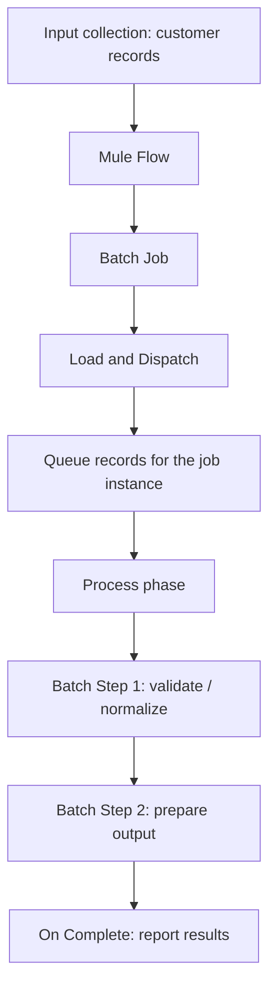

# 10.1 — Batch Processing in Mule 4

**Batch processing** is used when an integration must process a collection of records, especially larger datasets, record by record—such as synchronizing customers, importing product data, or processing payroll records. Instead of designing a separate flow execution manually for every item, Mule's Batch Job component manages the records and their progress through batch steps.

This tutorial builds a small customer-import example with sample JSON records. You will see how to configure a Batch Job and Batch Step, run the application, and inspect the results.

## 1. When should you use batch processing?

Batch processing is a good fit for a finite collection of records that need similar processing, for example:

- Importing thousands of customers from a file.
- Synchronizing product records between two systems.
- Validating and transforming an employee export.
- Sending many records to an external system with controlled concurrency.

For a single request/response operation or a small interactive API call, a normal flow is often simpler. Batch processing is asynchronous: the flow that starts a Batch Job does not wait for every record to finish, and a normal HTTP response cannot contain the final batch-job result.

## 2. Batch processing overview



The Batch Job component splits a supported collection payload into records. Each record moves through the configured steps. Batch processing provides record-level success/failure tracking and processing controls for large collections. <sup>[MuleSoft Batch Component Reference](https://docs.mulesoft.com/mule-runtime/latest/batch-reference)</sup>

## 3. Official MuleSoft Studio screenshots

These are **real screenshots from official MuleSoft documentation/tutorials**, used as visual references. The Studio layout may differ by version; follow the component names and values in the steps below.

**Batch Job component in Anypoint Studio**


*Reference: [Create a batch ETL integration — MuleSoft Developers](https://developer.mulesoft.com/tutorials-and-howtos/integrations/creating-batch-etl-integration/).*

**Batch Job general settings**


*Reference: [Batch Component Reference](https://docs.mulesoft.com/mule-runtime/latest/batch-reference).*

## 4. Worked implementation: Customer Import

We will process three customers. In each record, the Batch Step will normalize the customer's name and determine a basic eligibility flag. This example demonstrates the structure of a real batch job while avoiding a dependency on a database or external service.

### Sample input

The input to the Batch Job must be a supported collection, such as a JSON array:

```json
[
  { "customerId": 101, "name": "  Asha Sharma ", "active": true },
  { "customerId": 102, "name": "Ravi Kumar", "active": false },
  { "customerId": 103, "name": "  Neha Singh", "active": true }
]
```

### Build it in Anypoint Studio

1. Create a new Mule project named `batch-customer-import`.
2. Add a flow named `customerImportFlow`.
3. Add a **Scheduler** source so you can run the demo without an HTTP request. Configure it to run at a convenient interval while testing. Alternatively, use an HTTP Listener as the source and place the sample array in a Transform Message immediately before the Batch Job.
4. Add a **Transform Message** before the Batch Job and configure its output as JSON using the sample array above. This produces the collection that the Batch Job will split into records.
5. Drag a **Batch Job** after Transform Message. Name it `Customer_Import_Job`.
6. Inside the Batch Job, add at least one **Batch Step** named `Normalize_Customer`.
7. Inside the Batch Step, add a **Transform Message** that normalizes each record using the script below. Within a Batch Step, `payload` represents the current record, not the original full array.
8. Add a Logger after the Batch Job in the outer flow if you want to log that the flow has handed the collection to batch processing. This Logger does **not** mean all records have finished. For a completion summary, use the Batch Job's **On Complete** scope.
9. Save and run the application. Check the console logs and Batch Job configuration to observe the job execution.

### Important setup note

The **Scheduler** triggers repeatedly. For a first test, choose a long enough interval to avoid starting new batches while you inspect the previous run; stop the application when finished. If you use an HTTP Listener instead, keep in mind that the response is sent before asynchronous batch processing necessarily completes.

### Transform each record in the Batch Step

Use this DataWeave script in the Transform Message inside `Normalize_Customer`:

```dataweave
%dw 2.0
output application/json
---
{
  customerId: payload.customerId,
  name: trim(payload.name default ""),
  active: payload.active default false,
  eligibleForImport: (payload.active default false) and !isEmpty(trim(payload.name default ""))
}
```

The Batch Step runs this transformation for each record. For the three sample records, the normalized records should logically be:

```json
[
  {
    "customerId": 101,
    "name": "Asha Sharma",
    "active": true,
    "eligibleForImport": true
  },
  {
    "customerId": 102,
    "name": "Ravi Kumar",
    "active": false,
    "eligibleForImport": false
  },
  {
    "customerId": 103,
    "name": "Neha Singh",
    "active": true,
    "eligibleForImport": true
  }
]
```

This is the expected per-record transformation result for learning purposes. The Batch Job does not automatically return the transformed record list as the outer flow's payload; batch records and the job report have their own lifecycle.

## 5. What to observe when you run it

- The input array is split into three individual records.
- The Batch Job creates a batch job instance.
- Each record passes through the configured Batch Step.
- The step transforms each customer's name and adds `eligibleForImport`.
- Batch processing tracks successful and failed records.
- The On Complete scope can log or act on the batch result object when processing finishes.

To make record-level behavior easier to observe, add a Logger inside the Batch Step after the transformation and use a message such as `#[payload]`. Avoid logging sensitive customer information in real applications.

## 6. Batch Job configuration concepts

| Setting | Meaning |
|---|---|
| Name | A meaningful name used to identify the Batch Job in Studio |
| Batch Step | A processing stage that acts on each accepted record |
| Batch Block Size | Number of records grouped into a block for processing; defaults and limits are runtime/version-dependent, so consult the current reference |
| Max Concurrency | Controls how many record blocks can be processed concurrently |
| Max Failed Records | Sets the failure threshold for the job instance; default behavior stops when the configured threshold is reached |
| On Complete | Runs after the batch instance finishes and can inspect its result summary |

Tune block size and concurrency only after measuring the workload. Larger values are not automatically faster: record size, connector throughput, CPU, memory, and downstream rate limits all matter.

## 7. Common mistakes

- Passing a string or an object where a supported collection is expected. A JSON array is appropriate for this example.
- Assuming the payload inside a Batch Step is the full array. It represents the current record.
- Expecting the outer flow's next processor to receive the final list of transformed records.
- Putting completion reporting in a Logger immediately after Batch Job rather than inside the On Complete scope.
- Making a batch step depend on another record's processing order. Records may be processed in blocks and concurrently.
- Using Scheduler with a very short interval during testing and accidentally starting overlapping job instances.

## Practice checklist

- [ ] Run the example with three input records.
- [ ] Add a fourth record with a blank name and observe its `eligibleForImport` value.
- [ ] Add a Logger inside the Batch Step and inspect the current record payload.
- [ ] Explain why the flow can continue before batch processing is complete.
- [ ] Find the Batch Job result in the On Complete scope.

## Independent practice challenge

Create a batch job to process four product records. Each record contains `sku`, `name`, `price`, and `active`. Normalize whitespace in the product name, add `priceWithTax` using a 5% tax rate, and add `publishable` as true only when the product is active and the name is not blank. Test one inactive product and one product with a blank name.

## Official references

- [Batch Processing — Mule Runtime](https://docs.mulesoft.com/mule-runtime/latest/batch-processing-concept)
- [Batch Component Reference](https://docs.mulesoft.com/mule-runtime/latest/batch-reference)
- [Create a batch ETL integration — MuleSoft Developers](https://developer.mulesoft.com/tutorials-and-howtos/integrations/creating-batch-etl-integration/)
