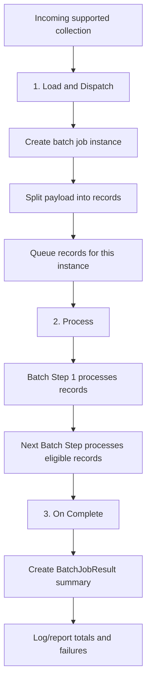

# 10.2 — Batch Execution Phases in Mule 4

A Mule 4 Batch Job executes through **three phases**: **Load and Dispatch**, **Process**, and **On Complete**. Understanding these phases helps you know when records are created, when Batch Steps run, how record failures are tracked, and where to put completion reporting.

This lesson explains each phase and implements a customer sync job you can run in Anypoint Studio.

## 1. The three batch execution phases



MuleSoft documents these phases as the lifecycle of a batch job instance. The Process phase is asynchronous relative to the flow that triggers the Batch Job. The On Complete phase is for reporting and follow-up based on the job result, not for returning a transformed array to the original caller. <sup>[Batch Job Phases](https://docs.mulesoft.com/mule-runtime/latest/batch-phases)</sup>

## 2. Phase 1 — Load and Dispatch

This phase prepares the input before record processing:

1. Mule creates a new batch job instance and assigns it an instance ID.
2. The input payload is split into individual records.
3. Records are put into a queue for that instance.
4. The job is prepared for execution through the configured Batch Steps.

You normally do not add separate processors for this phase. It is managed by the Batch Job component.

**Input requirement:** the payload must be a supported collection that Mule can split, such as a JSON array. If the payload is a plain string instead of a collection, the batch input preparation can fail.

### Official screenshot — Batch Job configuration


*Reference: [MuleSoft Batch Component Reference](https://docs.mulesoft.com/mule-runtime/latest/batch-reference). Fields shown may differ across runtime versions.*

## 3. Phase 2 — Process

This is where record-level logic runs.

- Configure one or more **Batch Step** components inside the Batch Job.
- Each step operates on individual records.
- Mule can process different blocks concurrently, while records inside a block pass through the components sequentially.
- Failed records are tracked. Depending on the configured failure threshold and acceptance policy, failed records can affect later steps or cause processing to stop.

### Official screenshot — Batch Step configuration


*Reference: [MuleSoft Batch Component Reference](https://docs.mulesoft.com/mule-runtime/latest/batch-reference). The Accept Expression and Accept Policy settings help control which records a step processes.*

### Process phase diagram


*Reference: [Batch Job Phases](https://docs.mulesoft.com/mule-runtime/latest/batch-phases). This diagram illustrates records moving through sequential steps and back to the record stepping queue between steps.*

## 4. Phase 3 — On Complete

The **On Complete** scope runs after the batch instance finishes. It is the right place to log or report summary information, such as the number of successful and failed records.

In Studio, add an **On Complete** scope under the Batch Job and place a Logger inside it. Use the DataWeave editor's autocomplete or the current Batch Job documentation to inspect the available fields on the batch result object, since exact result properties and their types can vary by runtime version.

A typical goal is to report:

- Batch job instance identifier.
- Total number of records processed.
- Number of successful records.
- Number of failed records.
- Job status.

Do not put your per-record transformation here; On Complete handles the batch result summary, not each individual record payload.

## 5. Worked implementation: two-step customer sync

Build a job that:
1. **Load and Dispatch:** accepts a JSON array of customer records.
2. **Process — Step 1:** normalizes the name and checks whether the record is active.
3. **Process — Step 2:** logs only eligible records for a simulated downstream sync.
4. **On Complete:** logs that the batch instance has finished; configure richer result reporting using the available result fields in your Studio version.

### Sample records

```json
[
  { "customerId": 201, "name": "  Meera Shah ", "active": true },
  { "customerId": 202, "name": "Kabir Verma", "active": false },
  { "customerId": 203, "name": "  Isha Das", "active": true }
]
```

### Build the flow in Anypoint Studio

1. Create a new Mule project named `batch-phase-demo`.
2. Add a Scheduler source for a repeatable local demo. Set an interval long enough to inspect logs, and stop the application after testing.
3. Add a Transform Message before the Batch Job and return the JSON array above.
4. Add a Batch Job named `Customer_Sync_Job`.
5. In the Batch Job's Process area, create a first Batch Step named `Normalize_Customer`.
6. Inside Step 1, add Transform Message and use the script below.
7. Add a second Batch Step named `Sync_Eligible_Customer`. Configure its **Accept Expression** to accept records only when `#[payload.active and payload.name != null and !isEmpty(payload.name)]` evaluates to true, or implement the same check in a Choice Router inside the step if that is easier to follow in your Studio version.
8. Add a Logger in Step 2 with a message such as `#[ "Simulated sync for customerId: " ++ (payload.customerId as String) ]`.
9. Add an On Complete scope to the Batch Job and place a Logger inside it. Use a simple message such as `"Customer sync batch instance completed"`; then use Studio expression autocomplete to inspect the batch result object and add the success/failure counts supported by your runtime.
10. Run the app and inspect the console logs. You should see the eligible customers logged from Step 2 and the completion message after the job ends.

### Step 1 — Normalize the record

```dataweave
%dw 2.0
output application/json
---
{
  customerId: payload.customerId,
  name: trim(payload.name default ""),
  active: payload.active default false
}
```

### What each phase does in this example

| Phase | What you should observe |
|---|---|
| Load and Dispatch | One batch instance is created and the three customer objects are split into records |
| Process — Step 1 | Every record has its name trimmed and active flag defaulted |
| Process — Step 2 | Only records that meet the step's acceptance condition are passed to the simulated sync Logger |
| On Complete | The batch completion Logger runs after processing ends |

The sample uses a Logger rather than a real system update, so it is safe to run repeatedly. A production sync would typically include the target system connector operation, retry strategy, validation, and carefully designed error handling.

## 6. Record failures and the next step

Batch processing tracks whether records succeed or fail in a Batch Step. Review the Batch Job's **Max Failed Records** setting and each step's **Accept Policy** / **Accept Expression** options:

- A failed record may be excluded from subsequent steps, depending on acceptance behavior.
- A maximum-failure threshold can halt further processing and lead to On Complete.
- If the job must continue past record-level failures, configure and test that policy intentionally; do not assume the defaults will continue.

For the current behavior and property defaults, use the [Batch Component Reference](https://docs.mulesoft.com/mule-runtime/latest/batch-reference) for the Mule Runtime version targeted by your application.

## 7. Common misunderstandings

- **“The flow ended, so the batch job must be finished.”** Not necessarily; batch processing runs asynchronously.
- **“On Complete contains every transformed record.”** It is for batch-result reporting, not a list of every record's output.
- **“A Batch Step sees the complete incoming array.”** Within a Batch Step, payload refers to the current record.
- **“Records always run in order.”** Blocks can execute concurrently, so do not depend on record order.
- **“If a record fails, every later record stops.”** Batch error behavior depends on max-failure and acceptance settings.

## Practice checklist

- [ ] Point to the Load and Dispatch, Process, and On Complete sections in Studio.
- [ ] Confirm the first step processes every customer record.
- [ ] Confirm the second step processes only eligible records.
- [ ] Verify that the completion Logger runs after record processing finishes.
- [ ] Make one input record inactive and observe that it is skipped by the second step.
- [ ] Explain how record failure policy affects subsequent steps.

## Independent practice challenge

Create a batch job that processes invoice records. The first step should normalize a `supplierName` field and calculate `totalAmount = quantity * unitPrice`. The second step should accept only invoices where `quantity > 0` and `unitPrice > 0`, then log a simulated submission message. Use On Complete to report the batch outcome using the result fields available in your runtime. Include at least one invalid record and verify how it is handled.

## Official references

- [Batch Job Phases](https://docs.mulesoft.com/mule-runtime/latest/batch-phases)
- [Batch Processing — Mule Runtime](https://docs.mulesoft.com/mule-runtime/latest/batch-processing-concept)
- [Batch Component Reference](https://docs.mulesoft.com/mule-runtime/latest/batch-reference)
- [Handling Errors During Batch Job](https://docs.mulesoft.com/mule-runtime/latest/batch-error-handling-faq)
