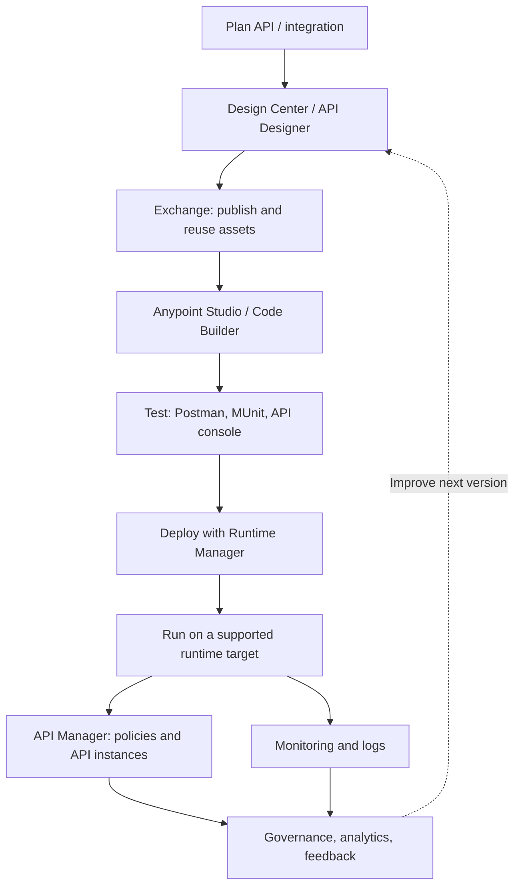
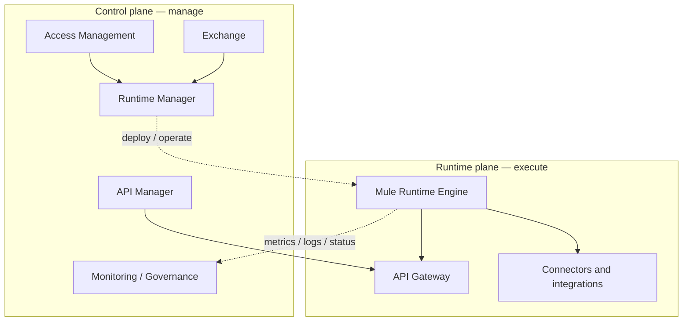
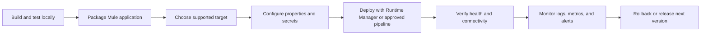
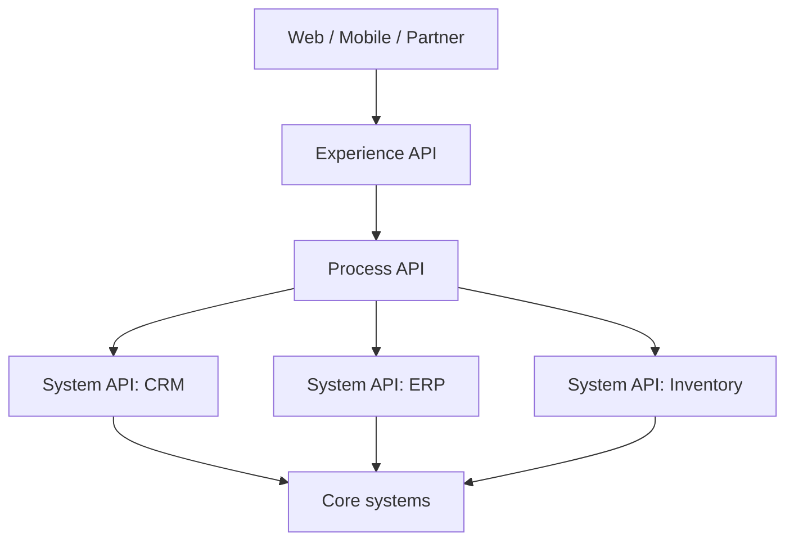

# Chapter 11 — Anypoint Platform: Complete Beginner's Guide

Anypoint Platform is MuleSoft's unified platform for designing, building, publishing, securing, deploying, operating, and governing APIs and integrations. It is not just one tool: it is a set of connected capabilities used by developers, architects, API owners, platform administrators, and operations teams.

This chapter is a practical tour of the important platform areas. Product availability, labels, navigation, and entitlements can differ by organization, subscription, region, and platform release. Use your organization's current Anypoint Platform UI and official documentation for version-specific details.

## 1. The big picture

Anypoint Platform helps teams manage the API and integration lifecycle:

1. **Discover and design** APIs and integrations.
2. **Build and test** Mule applications and API implementations.
3. **Publish and reuse** specifications, connectors, templates, and other assets.
4. **Deploy** applications and API gateways to supported runtime targets.
5. **Manage and secure** APIs, access, policies, and environments.
6. **Monitor and govern** production services and API quality.

### Diagram: platform lifecycle



The tools work together, but not every application must use every product. For example, an internal batch integration may not expose a public API, while an externally consumed API will usually need API lifecycle management and security controls.

## 2. Control plane and runtime plane

A foundational architecture concept is the separation between the **control plane** and **runtime plane**.

- **Control plane:** the management capabilities used to design, configure, deploy, and administer assets and applications.
- **Runtime plane:** the environment where Mule applications and API gateways actually execute and process traffic.

The control plane and runtime plane can have different hosting arrangements. Do not assume that because you manage an application through a web UI, its business payloads are necessarily processed in that same hosted location. Hosting choices and data flows depend on the deployment model and configuration.

### Diagram: management vs execution



See [Anypoint Platform Hosting Overview](https://docs.mulesoft.com/hosting-home/) for the current hosting model.

## 3. Main platform components at a glance

| Platform area | What it is used for | Typical user task |
|---|---|---|
| **Anypoint Studio** | Desktop IDE for implementing Mule applications | Build a flow with HTTP Listener, Transform Message, connectors, and error handling |
| **Anypoint Code Builder** | Browser-based development experience for supported API and integration projects | Create or edit API specifications and integration projects |
| **Design Center / API Designer** | Design and document API specifications, including RAML or OpenAPI-based APIs | Define resources, methods, request/response types, and examples |
| **Anypoint Exchange** | Catalog for discovering, publishing, and reusing API specs, connectors, templates, examples, and other assets | Find a connector or publish an API specification for teammates |
| **API Manager** | Manage API instances, policies, client applications, and API management configuration | Apply an authentication policy to a managed API |
| **Runtime Manager** | Deploy, operate, and manage Mule applications on supported targets | Deploy an application, restart it, or inspect deployment status |
| **Access Management** | Manage users, roles, permissions, business groups, and environments | Give a developer permission to deploy to a development environment |
| **Anypoint Monitoring** | Observe supported deployed applications and runtime behavior | Review logs, metrics, alerts, or dashboards where enabled |
| **API Governance** | Check API designs and specifications against organizational rulesets | Find design-standard violations before release |
| **Anypoint MQ** | Cloud messaging for asynchronous communication, where licensed and configured | Publish a message to a queue for another application to process |
| **Object Store** | Store key-value data or application state for supported use cases | Save idempotency state or a small processing checkpoint |
| **API Experience Hub** | Build a developer-facing catalog or portal for API products | Help consumers discover APIs and access documentation |
| **Flex Gateway / supported gateway capabilities** | Apply API management and security to APIs across supported environments | Manage traffic and policies for APIs that are not implemented as Mule flows |
| **Anypoint CLI and platform APIs** | Automate platform tasks and integrate with CI/CD workflows | Script deployments or automate asset publishing |

Availability and names may vary by subscription and release. See the [official Anypoint Platform product page](https://www.salesforce.com/mulesoft/anypoint-platform/) and the [MuleSoft documentation](https://docs.mulesoft.com/).

## 4. Design Center and API design

API design describes the contract consumers use before or independently of the implementation.

An API specification commonly defines:

- Base URL and resources/paths.
- HTTP methods such as GET, POST, PUT, PATCH, and DELETE.
- Path and query parameters.
- Request bodies and response schemas.
- Status codes and error formats.
- Examples, security schemes, and reusable data types.

RAML and OpenAPI are specification formats. They are not Mule runtime flows by themselves.

### Typical API design workflow

1. Create or import an API specification in the supported design tool.
2. Define resources, methods, parameters, payload schemas, and responses.
3. Add examples and security requirements.
4. Validate the specification and preview its documentation.
5. Publish the specification to Exchange.
6. Implement the API in Studio or a supported development environment.
7. Test the implementation against the specification.

Useful references:
- [API Designer](https://docs.mulesoft.com/design-center/)
- [RAML](https://raml.org/)
- [OpenAPI Specification](https://spec.openapis.org/oas/latest.html)

## 5. Anypoint Exchange: reuse instead of reinventing

Exchange is the catalog where teams can discover and share reusable assets. Depending on permissions and organization setup, assets may include:

- API specifications and API fragments.
- Connectors and connector documentation.
- Templates and examples.
- Integration assets and custom assets.
- Rulesets and other governance-related assets.
- Published APIs and related documentation.

### Example workflow

Suppose a team already has a Customer System API specification:

1. Search Exchange for the customer API asset.
2. Read its documentation, version, owner, and examples.
3. Confirm the version and access rights.
4. Reuse the specification or asset in your project.
5. Publish your own asset when it is ready for others.

**Best practice:** publish meaningful versions, document breaking changes, and avoid publishing credentials, tokens, customer data, or secrets inside examples.

Official reference: [Anypoint Exchange](https://docs.mulesoft.com/exchange/).

## 6. Anypoint Studio: implement the integration

Studio is the desktop IDE used in this learning path. A Mule application usually contains flows and components that process a Mule event.

Common components from earlier chapters include:

- HTTP Listener — receives an inbound HTTP request.
- Logger — writes diagnostic information.
- Transform Message — transforms data using DataWeave.
- Set Payload and Set Variable — update message payload or event variables.
- Choice Router — selects a route based on conditions.
- Scatter-Gather — processes independent routes concurrently and gathers their results.
- Batch Job — processes a collection of records.
- HTTP Request and other connectors — call external systems.

A simple development cycle is:

1. Create a Mule project.
2. Configure sources and connectors.
3. Implement the flow and error handling.
4. Run locally and test with Postman or another client.
5. Add automated tests where appropriate.
6. Package the application for deployment.
7. Deploy through the process supported by your organization.

Official reference: [Anypoint Studio](https://docs.mulesoft.com/studio/).

## 7. Runtime Manager and deployment targets

Runtime Manager is used to deploy and operate Mule applications on supported runtime targets. The exact targets available depend on the organization's subscription and architecture.

Common deployment concepts include:

- **CloudHub / CloudHub 2.0:** MuleSoft-managed cloud deployment options, with differences in architecture and configuration.
- **Runtime Fabric:** a deployment option for supported customer-managed infrastructure.
- **Hybrid or on-premises runtimes:** supported deployments running in infrastructure managed by the organization.
- **Private Cloud Edition:** a separately deployed Anypoint Platform control plane for organizations with specific hosting and isolation requirements.

Do not treat these deployment models as interchangeable. Their networking, scaling, availability, logging, secrets, and operational responsibilities differ.

### Deployment lifecycle diagram



Before deployment, verify runtime compatibility, environment-specific properties, connector credentials, network access, and the required permissions.

Official references:
- [Runtime Manager](https://docs.mulesoft.com/runtime-manager/)
- [CloudHub 2.0](https://docs.mulesoft.com/cloudhub-2/)
- [Runtime Fabric](https://docs.mulesoft.com/runtime-fabric/)
- [Anypoint Platform Private Cloud Edition](https://help.salesforce.com/s/articleView?id=001123144&type=1)

## 8. API Manager: manage and secure APIs

API Manager manages API instances and the policies and client access associated with them. It is different from the code that implements an API.

Common concepts:

- **API specification:** the contract, such as RAML or OpenAPI.
- **API implementation:** the Mule application or other service that performs the work.
- **API instance:** a managed API representation in an environment.
- **API policy:** a rule enforced by a supported gateway, such as authentication, rate limiting, or traffic controls.
- **Client application / client credentials:** the mechanism used by an API consumer to identify or authenticate an application, depending on the configured security model.
- **Analytics:** data about API usage and performance, where supported and enabled.

### Example: secure a customer API

1. Implement and test a customer endpoint locally.
2. Deploy the implementation to a development environment.
3. Register or manage the API instance in API Manager according to your organization's process.
4. Configure the supported gateway/API autodiscovery setup when required for a Mule application.
5. Apply a suitable policy, such as client ID enforcement or an OAuth-based policy, based on the API's threat model.
6. Create or authorize a client application using the organization's approved process.
7. Test both an authorized request and an unauthorized request.
8. Confirm that secrets are stored securely and that logs do not expose credentials.

Policy names, prerequisites, and enforcement behavior depend on the gateway type and version. Do not assume every policy can be applied to every runtime or gateway.

Official reference: [API Manager Overview](https://docs.mulesoft.com/api-manager/latest/latest-overview-concept).

## 9. Access Management: organizations, business groups, environments, and permissions

Access Management controls who can do what in the platform.

### Core terms

- **Organization:** the top-level organization boundary associated with the account.
- **Business group:** a logical subdivision used to organize assets, teams, and environments.
- **Environment:** a logical stage such as Development, Sandbox, QA, or Production. Actual names and available environments depend on the organization.
- **User and team:** identities assigned roles or permissions.
- **Role/permission:** defines allowed actions on platform resources.
- **Client application credentials:** credentials used by an application to access APIs or platform services; these are not the same as a human user's login.

### Recommended separation

| Environment | Typical use | Access approach |
|---|---|---|
| Development | Build and frequent testing | Developers can deploy to approved applications and test services |
| QA / Test | Integration and acceptance testing | Controlled test data and limited deployment permissions |
| Production | Live traffic | Least privilege, controlled releases, approved secrets, and auditability |

Never give every developer broad production permissions by default. Use least privilege, separate secrets per environment, and follow your organization's approval process.

Official references:
- [Access Management](https://docs.mulesoft.com/access-management/)
- [Permissions by Product](https://docs.mulesoft.com/access-management/permissions-by-product)
- [Business Groups](https://docs.mulesoft.com/access-management/business-groups)

## 10. API Governance: quality standards across teams

API Governance helps organizations evaluate API specifications against rulesets and standards. It can help teams identify issues such as inconsistent naming, missing documentation, or nonconforming design patterns before publication or release.

A governance workflow may include:

1. Define organizational rulesets.
2. Run conformance checks against API specifications.
3. Review violations and their severity.
4. Fix or formally waive violations according to team policy.
5. Repeat checks as the specification evolves.

Governance is not a substitute for runtime security testing or production monitoring. It primarily addresses design and standards conformance according to the rulesets configured.

Official reference: [Anypoint API Governance](https://docs.mulesoft.com/governance/).

## 11. Monitoring, logging, and troubleshooting

Production operations require more than checking whether an application is deployed.

Monitor the signals available in your deployment model:

- Application status and availability.
- Request volume, latency, and error rates.
- Connector and downstream-service failures.
- CPU, memory, and other runtime resource metrics where available.
- Application logs and correlation identifiers.
- Alerts, dashboards, and business-level indicators where configured.

### Troubleshooting workflow

1. Confirm the correct environment and deployed application version.
2. Check deployment and runtime status.
3. Inspect logs around the failure time and correlate the request.
4. Identify whether the issue is in the Mule flow, connector configuration, credentials, network, or downstream system.
5. Reproduce in a safe nonproduction environment if possible.
6. Fix the root cause, test, and deploy through the approved process.
7. Confirm recovery and document the incident if required.

Avoid logging passwords, access tokens, payment details, or unnecessary personal data. Redact sensitive fields and follow the organization's retention policy.

Official reference: [Anypoint Monitoring](https://docs.mulesoft.com/monitoring/).

## 12. Messaging and state: Anypoint MQ and Object Store

### Anypoint MQ

Anypoint MQ is a cloud messaging service for asynchronous communication between applications. A producer sends a message to a destination; a consumer receives and processes it later.

Use messaging when you need decoupling, buffering, asynchronous processing, or controlled consumption. Design for retries, duplicate delivery, message expiration, dead-letter handling where available, and idempotent consumers.

### Object Store

Object Store is used for supported key-value storage and state use cases. Examples include small state values, idempotency markers, or checkpoints. It is not a replacement for a full relational database or an unlimited data lake.

Availability, quotas, persistence, consistency, and deployment support depend on the particular Object Store offering and configuration.

Official references:
- [Anypoint MQ](https://docs.mulesoft.com/mq/)
- [Object Store v2](https://docs.mulesoft.com/object-store/)

## 13. API-led connectivity and application networks

API-led connectivity structures integration capabilities into reusable APIs, commonly described as:

- **System APIs:** provide controlled access to core systems and data.
- **Process APIs:** orchestrate or transform data and business processes across systems.
- **Experience APIs:** present capabilities in a form suited to a particular consumer or channel.

These are architectural roles, not mandatory technical product types. A well-designed API should have a clear purpose, ownership, contract, security model, and lifecycle.

### Example diagram



The layers can promote reuse and reduce point-to-point coupling, but adding layers without a clear need creates unnecessary complexity.

## 14. CI/CD and automation

For team-scale delivery, platform changes and application deployments are often automated.

A typical pipeline:

1. Store application and API specification source in version control.
2. Run formatting, static checks, and automated tests.
3. Package the application.
4. Publish versioned assets to Exchange when appropriate.
5. Deploy to a nonproduction environment.
6. Run smoke or integration tests.
7. Promote the approved artifact to production.
8. Verify health and retain a rollback plan.

Use the supported platform APIs, CLI, and CI/CD integrations available to your organization. Keep credentials in a secret store, use least-privilege service identities, and avoid embedding tokens in source code.

Useful reference: [Anypoint CLI](https://docs.mulesoft.com/anypoint-cli/).

## 15. Worked implementation: publish, deploy, and manage a simple API

This exercise connects the concepts from the chapter. It assumes you already built a simple Mule API in an earlier chapter.

### Goal

Deploy a simple `GET /hello` API to an approved development target, then locate the application in Runtime Manager and learn where API management fits.

### Part A — Prepare the application locally

1. Open Anypoint Studio and create or open a Mule project.
2. Configure an HTTP Listener with path `/hello`.
3. Add Set Payload with a small JSON response, for example:

```dataweave
%dw 2.0
output application/json
---
{
  message: "Hello from Anypoint Platform",
  status: "OK"
}
```

4. Run the app locally and call `http://localhost:8081/hello` using Postman.
5. Confirm that the response is valid JSON before proceeding.

### Part B — Prepare platform access

1. Sign in to your organization's Anypoint Platform account.
2. Confirm that you have access to the correct business group and **development** environment.
3. Ask your platform administrator for the approved deployment target and required permissions if you do not see one.
4. Confirm how your organization manages deployment properties, secure configuration, and application credentials.

### Part C — Deploy

1. Package the Mule application using the deployment method supported by your team.
2. In Runtime Manager, choose the correct environment and deployment target.
3. Create a deployment for the application and supply the required artifact and environment-specific configuration.
4. Wait for the deployment to reach a healthy/running state.
5. Open the deployed application's details and inspect its status and available logs.
6. Use the deployed URL provided by your target to call `/hello`. Do not assume the deployed URL will use localhost or port 8081.

**Note:** Deployment UI fields and required settings differ by target and organization. Follow the current Runtime Manager guide and your team's approved deployment process. Do not deploy to production as part of this practice exercise.

### Part D — Understand API Manager's role

A deployed application is not automatically secured by every API policy. If this endpoint is intended to be a managed API:

1. Follow your organization's process to register/manage the API instance in API Manager.
2. Configure any required gateway or autodiscovery integration for the chosen architecture.
3. Apply a suitable security policy in the development environment.
4. Test expected authorized and unauthorized behavior.
5. Check the API instance's analytics or monitoring features if available.

If you do not have deployment permissions or a cloud target, complete Parts A and B and walk through the deployment documentation. Access to platform features depends on your organization's account and subscription.

### Expected learning outcome

You should be able to explain the distinction between:

- Building the API in Studio.
- Publishing reusable API assets in Exchange.
- Deploying and operating the application in Runtime Manager.
- Managing API instances and policies in API Manager.
- Controlling access through Access Management.
- Monitoring and governing the service after release.

## 16. Practical checklist

- [ ] Explain the difference between control plane and runtime plane.
- [ ] Describe the roles of Studio, Design Center, Exchange, Runtime Manager, and API Manager.
- [ ] Explain the difference between an API specification and an API implementation.
- [ ] Identify where users, business groups, environments, and permissions are managed.
- [ ] Explain why deployment does not automatically mean an API is secured.
- [ ] Describe one appropriate use case for Anypoint MQ and one for Object Store.
- [ ] Explain how monitoring and API governance differ.
- [ ] Deploy or walk through the deployment of a simple API in a development environment.

## 17. Quick reference: which tool should I open?

| If you need to… | Start with… |
|---|---|
| Design an API contract | Design Center / API Designer |
| Find a reusable API or connector | Exchange |
| Build a Mule flow | Anypoint Studio or a supported Code Builder workflow |
| Deploy or restart an application | Runtime Manager |
| Configure policies for a managed API | API Manager |
| Manage users, permissions, business groups, environments | Access Management |
| Review supported runtime logs and metrics | Monitoring and Runtime Manager |
| Check API design against standards | API Governance |
| Send messages asynchronously | Anypoint MQ |
| Store supported key-value state | Object Store |
| Automate platform tasks | Anypoint CLI and supported platform APIs |

## Official documentation and further reading

- [Anypoint Platform — Salesforce](https://www.salesforce.com/mulesoft/anypoint-platform/)
- [MuleSoft Documentation](https://docs.mulesoft.com/)
- [API Manager Overview](https://docs.mulesoft.com/api-manager/latest/latest-overview-concept)
- [Anypoint Platform Hosting Overview](https://docs.mulesoft.com/hosting-home/)
- [Anypoint Exchange](https://docs.mulesoft.com/exchange/)
- [Runtime Manager](https://docs.mulesoft.com/runtime-manager/)
- [Access Management](https://docs.mulesoft.com/access-management/)
- [API Governance](https://docs.mulesoft.com/governance/)
- [Anypoint Monitoring](https://docs.mulesoft.com/monitoring/)
- [Anypoint MQ](https://docs.mulesoft.com/mq/)
- [Object Store](https://docs.mulesoft.com/object-store/)
