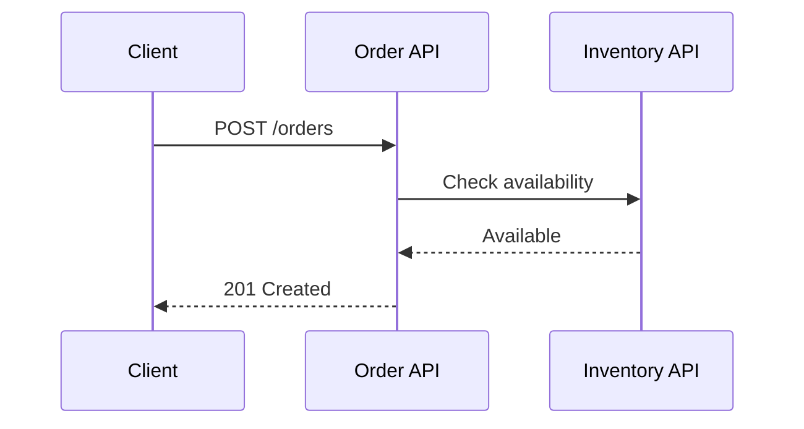
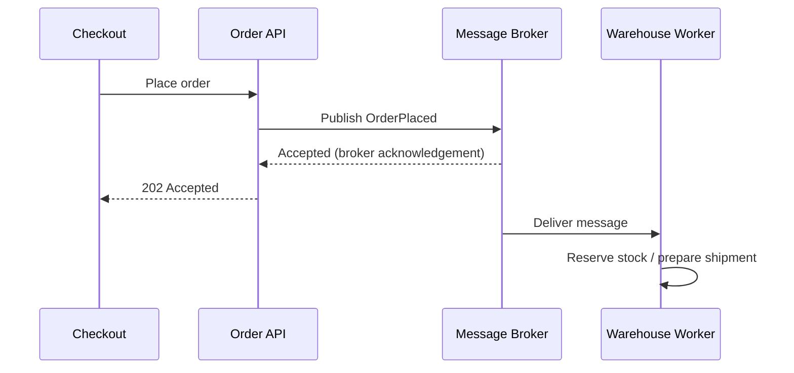
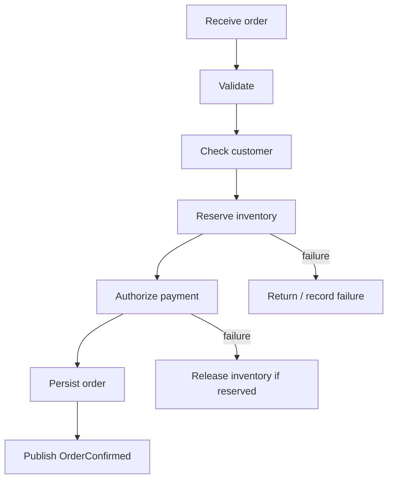

# Chapter 12.1 — Synchronous vs Asynchronous Communication and Orchestration

Before learning messaging technologies, understand **when systems wait for one another, when they do not, and how an integration coordinates work**. These concepts explain why an API might call another API directly in one situation and publish a message in another.

## Learning objectives

By the end, you should be able to:
- Distinguish synchronous from asynchronous communication.
- Select a communication style for a real business requirement.
- Explain orchestration and how it differs from choreography.
- Recognize timeouts, retries, duplicate processing, and eventual consistency.
- Sketch an integration before implementing it in Mule 4.

## 1. The basic idea

### Synchronous communication

The caller sends a request and waits for a response before continuing. HTTP request/response APIs are a common example.

**Good fit:** a user needs an immediate answer, such as checking a balance, validating an address, or looking up a product price.

**Trade-offs:** the caller experiences downstream latency; timeouts or an unavailable dependency can break the request path. Keep synchronous chains short and set sensible connection/read timeouts.

### Asynchronous communication

The producer sends work to a queue, topic, or other intermediary and can continue without waiting for the consumer to finish the business operation. The consumer processes the message later.

A broker acknowledgement means the message was accepted according to that broker's configuration; it does **not** mean the warehouse completed the work. Use a status endpoint, callback, webhook, or notification if the client needs the eventual result.

**Good fit:** sending receipts, processing images, updating search indexes, creating shipment tasks, and distributing events to multiple systems.

**Trade-offs:** more moving parts, eventual consistency, message redelivery, duplicate handling, and more involved troubleshooting.

## 2. Compare the two styles

| Question | Synchronous | Asynchronous |
|---|---|---|
| Does the caller wait for the business operation? | Usually yes | Usually no |
| Typical interface | HTTP request/response | Queue/topic/message |
| Coupling | Runtime and timing are more tightly coupled | Producer and consumer can be decoupled in time |
| Failure signal | Response, timeout, or connection error | Broker acknowledgement, later processing result, or dead-letter handling |
| Best for | Immediate decisions and reads | Background work, buffering, fan-out |
| Consistency | Often immediate within the request path | Often eventual |

Neither style is universally better. A single solution can use both: an HTTP API accepts an order synchronously, then publishes an event for asynchronous fulfillment.

## 3. What is orchestration?

**Orchestration** is the explicit coordination of a business process by a central flow or service. It decides which steps run, in what order, how data is transformed, and what happens when a step fails.

Example: an order orchestration flow:
1. Validate the order.
2. Check customer eligibility.
3. Reserve inventory.
4. Authorize payment.
5. Save the order.
6. Publish an `OrderConfirmed` message.
7. If a later step fails, apply a defined recovery or compensation strategy.

In Mule 4, orchestration may use a flow, Flow Reference, Choice router, Try scope and error handlers, HTTP Request, database connectors, and messaging connectors. Use the right components for each system; do not treat a diagram as a guarantee of transactionality.

### Orchestration vs choreography

- **Orchestration:** a coordinator directs the steps. The business sequence is easier to see in one place, but the coordinator owns more process logic.
- **Choreography:** services publish and react to events without one central coordinator directing every step. This can reduce central coupling, but the overall process is harder to trace and govern.

A practical guideline: use orchestration when the process has a clear sequence, decision points, deadlines, or compensating actions. Consider choreography when independent services react to domain events and central coordination would add unnecessary coupling. Many systems combine both.

## 4. Common reliability concepts

- **Timeout:** the caller stops waiting. The downstream operation may still have completed; do not assume a timeout means “nothing happened.”
- **Retry:** repeat a failed attempt only when it is safe and the error is transient. Use bounded retries and backoff.
- **Idempotency:** processing the same request/message more than once produces the same intended business outcome. Use an order ID or idempotency key and a durable deduplication strategy.
- **Eventual consistency:** systems may temporarily show different states while asynchronous updates are in flight.
- **Compensation:** a business action that counteracts an earlier completed action, such as releasing a stock reservation after payment fails. This is not the same as rolling back a distributed database transaction.
- **Correlation ID:** a shared identifier used to trace one business operation across APIs, queues, and workers.

## 5. Choosing a pattern: real use cases

| Use case | Recommended starting point | Why |
|---|---|---|
| Product detail shown on a page | Synchronous API | The user needs the result now |
| Submit order, then prepare shipment | Synchronous acceptance + asynchronous event | Fast response; warehouse work can be retried |
| Generate monthly PDF statements | Asynchronous queue | Large, slow workload; can be buffered |
| Validate payment authorization before confirming checkout | Synchronous call or carefully designed payment workflow | A decision is needed before confirming |
| Notify CRM, analytics, and loyalty after purchase | Publish event; multiple consumers | Independent downstream work |
| Update a cache after a product change | Asynchronous event | Cache refresh need not block the product update |

## 6. A MuleSoft implementation outline

**Synchronous API**
1. Add an HTTP Listener for `POST /orders/validate`.
2. Validate required fields and return a clear 400 response for invalid input.
3. Use HTTP Request to call the required validation service.
4. Transform the result with DataWeave and return an appropriate HTTP status.
5. Configure timeouts and an error handler for expected failures.

**Asynchronous workflow**
1. Receive `POST /orders` and validate the request.
2. Create a durable order ID and store the accepted order.
3. Publish an `OrderPlaced` message to a queue.
4. Return `202 Accepted` with the order ID and a status URL.
5. A separate consumer processes the message and records success/failure.
6. Make the consumer idempotent; configure retry and dead-letter handling according to the broker and connector.

These are architecture steps, not copy-paste XML. Connector names, operations, acknowledgements, and transaction support depend on the chosen broker and connector version.

## 7. Practice challenge

Design an online bookstore checkout:
- Which checks must complete before the API returns a confirmed order?
- Which tasks can run asynchronously?
- What happens if payment succeeds but shipment creation fails?
- How will a duplicate `OrderPlaced` message be handled?
- What identifier will connect the API log, broker message, and shipment record?

Write a sequence diagram and justify each synchronous/asynchronous boundary.

## Key takeaways

1. Synchronous communication is useful when the caller needs an immediate answer.
2. Asynchronous messaging separates acceptance from completion and helps buffer workloads.
3. Orchestration explicitly coordinates a multi-step business process.
4. Retries, idempotency, observability, and compensation must be designed—not added as afterthoughts.

## Official references

- [MuleSoft documentation](https://docs.mulesoft.com/)
- [Mule 4 error handling](https://docs.mulesoft.com/mule-runtime/latest/intro-error-handling)
- [Mule Flow Reference component](https://docs.mulesoft.com/mule-runtime/latest/flowref-about)
