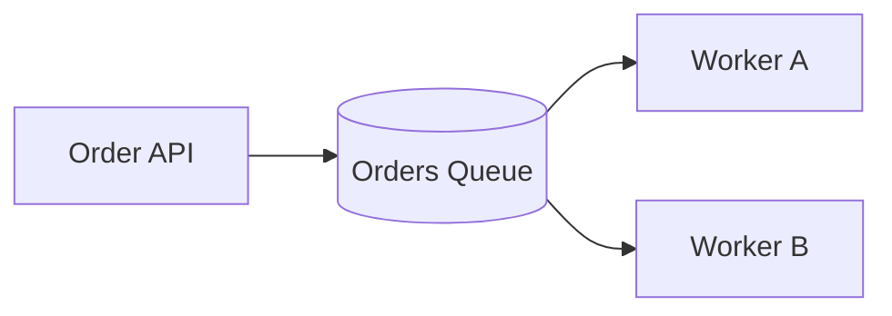
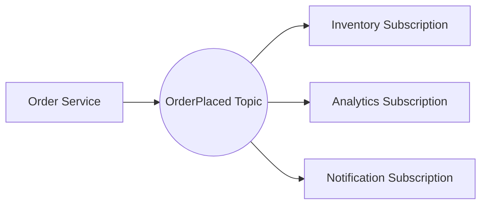

# Chapter 12.2 — JMS, Queues, Topics, and Message Delivery

Now that synchronous and asynchronous communication are clear, the next step is understanding **JMS** and the messaging patterns it standardizes.

## 1. What is JMS?

**JMS (Jakarta Messaging; historically Java Message Service)** is a Java API specification for sending and receiving messages through a messaging provider. JMS defines programming interfaces and messaging concepts; it is **not itself a broker** and does not run a message server.

A JMS provider/broker implements the messaging capabilities. Examples include ActiveMQ and other JMS-compatible products. The exact supported JMS version and features depend on the provider.

Core concepts:
- **Producer:** creates and sends a message.
- **Consumer:** receives and processes a message.
- **Destination:** the named location to which a message is sent.
- **Message:** the envelope carrying a payload and metadata.
- **Connection/session:** client-side resources used to communicate with the provider.
- **Acknowledgement:** indicates when a delivery is considered handled, according to the configured mode.
- **Durable subscription:** allows a topic subscription to retain eligible messages while the subscriber is offline, subject to provider configuration and retention.

## 2. Queue vs topic

### Point-to-point queue

A producer sends a message to a queue. Competing consumers generally share the workload: each message is processed by one consumer in the normal successful-delivery case. Redelivery can occur after failure, so “one consumer” does not mean “exactly once in the business system.”



**Example:** each order should be handled by a fulfillment worker. Add consumers to increase throughput, while keeping processing safe for concurrent execution.

### Publish-subscribe topic

A producer publishes a message to a topic. Each eligible subscription receives its own copy, so several systems can independently react to the same event.



**Example:** when an order is placed, inventory, analytics, and notifications each need to react. A topic is appropriate if each subscriber should receive the event. Durable delivery and offline retention depend on the subscription and broker configuration.

| Feature | Queue | Topic |
|---|---|---|
| Common model | Point-to-point | Publish-subscribe |
| Typical consumer behavior | Competing consumers share work | Each subscription receives the event |
| Good for | Work items, jobs, commands | Events for multiple independent systems |
| Main design question | Which worker handles this job? | Which subscribers need this event? |

## 3. Message contents and headers

A message typically contains:
- **Payload:** business data, often JSON or XML.
- **Message ID:** identifier assigned by the provider or message layer.
- **Correlation ID:** relates a reply or downstream event to the originating operation.
- **Reply-to destination:** where a reply should be sent in request/reply messaging.
- **Properties/headers:** routing and processing metadata, depending on provider.
- **Timestamp and delivery metadata:** available according to provider and configuration.

Example order event payload:

```json
{
  "eventType": "OrderPlaced",
  "eventVersion": 1,
  "eventId": "evt-100045",
  "orderId": "ORD-100045",
  "customerId": "C-204",
  "total": 149.95,
  "currency": "USD"
}
```

The IDs are illustrative. In production, define a stable event schema, versioning rules, required fields, and privacy boundaries. Avoid putting secrets or unnecessary personal data into messages.

## 4. Delivery semantics

- **At-most-once:** a message is not redelivered, but a failure can cause loss.
- **At-least-once:** a message may be redelivered; consumers must tolerate duplicates.
- **Exactly-once:** often advertised with a narrow technical scope. End-to-end exactly-once business effects across a broker, database, and external API are difficult and should not be assumed.

For most integration designs, plan for **at-least-once delivery plus idempotent processing**.

### Acknowledgement and redelivery

A consumer should acknowledge a message only at the point that matches the intended reliability guarantee. Acknowledging before durable business processing can lose work if the worker crashes afterward. Acknowledging too late can cause redelivery. Exact controls differ by connector and provider.

### Retry and dead-letter queues

Repeatedly retrying a permanently invalid message can block useful work. Use bounded retries and route poison messages to a dead-letter destination for inspection and controlled replay. Define:
- Which errors are transient vs permanent.
- Maximum attempts and delay/backoff.
- Alerting and ownership for dead-letter messages.
- Safe replay and deduplication procedures.

## 5. Request/reply over messaging

Sometimes the caller needs a result, but a direct HTTP connection is unsuitable. Messaging request/reply uses a request destination and a reply destination, linked by a correlation ID. It is still asynchronous at the transport level and can be more complex than a direct API call.

Use it when the system architecture requires messaging boundaries, not merely because a queue is available. Define reply timeouts, late replies, correlation, and error behavior.

## 6. JMS in a MuleSoft architecture

A typical flow:
1. An inbound API validates an order.
2. A JMS producer sends an order message to a configured queue.
3. A separate Mule flow consumes the queue.
4. The consumer transforms the payload and invokes downstream systems.
5. The flow acknowledges according to the connector/provider configuration.
6. Failures follow the configured retry, redelivery, and dead-letter strategy.

MuleSoft has a JMS connector for JMS providers. Connection settings, destinations, acknowledgement modes, transactions, and supported provider versions must be checked against the specific connector release and broker. Do not assume that a generic JMS connector automatically connects to every broker with identical behavior.

## 7. Security and operations checklist

- Use TLS where supported and required.
- Store credentials securely; do not commit passwords in XML or properties.
- Apply least-privilege permissions to destinations.
- Set message expiry/TTL when stale messages should not be processed.
- Monitor queue depth, oldest-message age, consumer count, error rate, and redelivery count.
- Define payload size limits and schema/version compatibility.
- Avoid logging full messages when they contain sensitive information.

## 8. Practice challenge

Design a queue for invoice generation:
1. Define the event payload.
2. Choose an idempotency key.
3. Decide when the consumer should acknowledge.
4. Define retry limits and a dead-letter process.
5. Explain what support staff should do with a failed invoice message.

## Key takeaways

JMS is a Java messaging API, not a broker. Queues usually distribute work among competing consumers; topics distribute events to subscriptions. Delivery guarantees depend on provider and configuration, so design for duplicate handling and operational recovery.

## Official references

- [MuleSoft JMS Connector documentation](https://docs.mulesoft.com/jms-connector/latest/)
- [Apache ActiveMQ documentation](https://activemq.apache.org/components/classic/documentation/)
