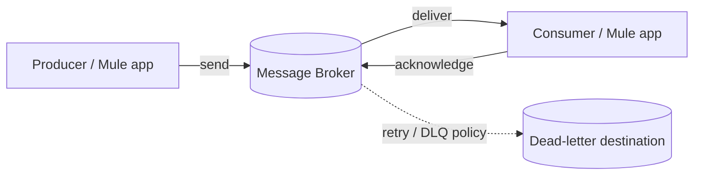
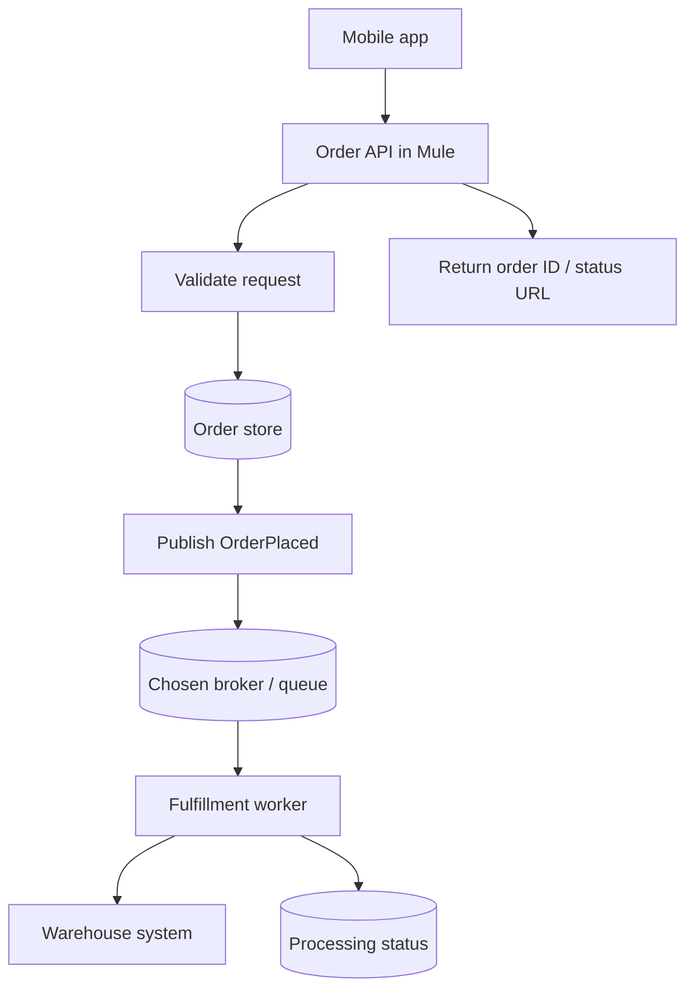

# Chapter 12.3 — Message Brokers, ActiveMQ, and Anypoint MQ

JMS explains a messaging API. A **message broker** is the running service that accepts, stores, routes, and delivers messages. This lesson separates the general broker concept from two technologies beginners commonly encounter: Apache ActiveMQ and MuleSoft Anypoint MQ.

## 1. What does a broker do?

A broker sits between producers and consumers. Depending on the product and configuration, it can:
- Accept messages and route them to destinations.
- Buffer messages while consumers are offline or slower than producers.
- Deliver messages to consumers and track acknowledgements.
- Redeliver messages after eligible failures.
- Support queues, topics, subscriptions, and dead-letter handling.
- Enforce authentication, authorization, TLS, and operational limits.
- Expose metrics and administrative controls.

A broker can smooth traffic spikes, but it does not make an application infinitely scalable or automatically guarantee exactly-once business processing. Storage durability, replication, retention, quotas, and acknowledgements are product-specific.

## 2. Apache ActiveMQ

**Apache ActiveMQ** is an open-source message-broker project. The name is often used to refer to **ActiveMQ Classic**, while **ActiveMQ Artemis** is a separate broker implementation in the same project family. They are not interchangeable in every configuration or protocol detail.

Common reasons to use an ActiveMQ deployment:
- Existing Java/JMS applications need a broker.
- An organization operates its own messaging infrastructure.
- Internal applications require queues, topics, and configured delivery policies.
- The team needs control over broker deployment and operations.

Before choosing a version, check the current ActiveMQ documentation, supported protocols, security advisories, and compatibility matrix. The JMS API level, wire protocol, and broker implementation all matter.

## 3. Anypoint MQ

**Anypoint MQ** is MuleSoft's managed cloud messaging service, designed for decoupling applications and integrating messaging into Anypoint Platform. It is not simply another name for ActiveMQ and should not be assumed to expose the same broker protocols or JMS interfaces.

Typical use cases:
- Buffer work between Mule applications.
- Publish an event for asynchronous processing.
- Decouple API acceptance from background processing.
- Deliver a message to an independent consumer application.
- Use managed messaging capabilities instead of operating a broker cluster yourself.

Anypoint MQ has its own destinations, APIs, connector configuration, permissions, quotas, and delivery behavior. Confirm the current product documentation and your organization's entitlements before implementation.

## 4. ActiveMQ vs Anypoint MQ

| Decision point | Apache ActiveMQ | Anypoint MQ |
|---|---|---|
| Operating model | Commonly self-managed; deployment model depends on organization | Managed service in the Anypoint ecosystem |
| Primary fit | Existing JMS/broker estate, control over infrastructure | MuleSoft integration workflows and managed messaging |
| Interface | JMS and supported wire protocols vary by broker/version | Anypoint MQ APIs and Mule connector; do not assume JMS compatibility |
| Operations | Your team may own installation, patching, scaling, HA, monitoring | MuleSoft manages the service infrastructure; your team still owns configuration, access, message design, and consumer reliability |
| Portability | Depends on protocols and provider-specific features | Service-specific configuration and APIs can create vendor coupling |
| Choose when | Existing platform, protocol, or operational needs point to it | Managed integration messaging is the right fit and is available to your organization |

The right choice depends on existing systems, throughput, latency, resilience, compliance, skills, cost, and operational ownership—not just product popularity.

## 5. How a Mule application connects

### JMS connector with a JMS provider

A Mule application can use the JMS connector when the target provider and version are compatible. Configure the provider-specific connection, destination, credentials, and acknowledgement/transaction behavior. Verify supported combinations in the connector documentation.

### Anypoint MQ connector

A Mule application can use the Anypoint MQ connector to publish to and consume from configured Anypoint MQ destinations. Set up the required access and destination configuration in Anypoint Platform, then configure the connector and error handling in Studio.

**Important:** JMS and Anypoint MQ are not synonyms. A JMS connector expects a compatible JMS provider; Anypoint MQ uses its own service and connector model. Choose the connector that matches the actual service.

## 6. Example architecture: order accepted, fulfillment later

This is a conceptual architecture, not a promise that a database write and message publish are automatically atomic. If the order is saved but publishing fails, the design needs recovery—for example, an outbox pattern, reconciliation, or a retryable publication record.

## 7. Broker selection checklist

Ask:
1. Does the existing application require JMS, AMQP, MQTT, or another protocol?
2. Is the target service actually compatible with the chosen connector?
3. Who patches, scales, secures, backs up, and monitors the broker?
4. What are the throughput, message-size, retention, and latency requirements?
5. What are the expected outage and recovery objectives?
6. How are retries, duplicate messages, dead-letter messages, and replay handled?
7. How are credentials and destination permissions managed?
8. What is the migration plan if the provider changes?

## 8. Practice challenge

Your company runs a legacy Java application using JMS and is building new Mule integrations in Anypoint Platform. Propose two designs:
- Reuse a compatible ActiveMQ broker.
- Use Anypoint MQ for new asynchronous integration paths.

For each design, identify connector compatibility, operational ownership, failure recovery, security, and migration considerations. Do not assume one design wins without requirements.

## Key takeaways

- A broker is the intermediary that stores/routes/delivers messages.
- ActiveMQ Classic and Artemis are distinct implementations; verify versions and protocols.
- Anypoint MQ is a managed MuleSoft messaging service, not simply an ActiveMQ alias.
- Select a broker and connector based on real compatibility and operational requirements.

## Official references

- [Apache ActiveMQ Classic documentation](https://activemq.apache.org/components/classic/documentation/)
- [Apache ActiveMQ Artemis documentation](https://activemq.apache.org/components/artemis/documentation/)
- [MuleSoft Anypoint MQ documentation](https://docs.mulesoft.com/mq/)
- [MuleSoft JMS Connector documentation](https://docs.mulesoft.com/jms-connector/latest/)
