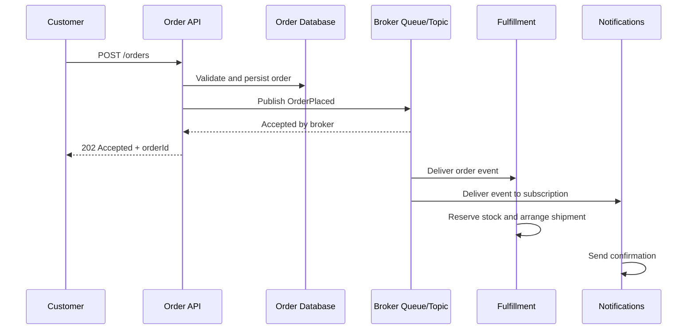

# Chapter 12.4 — Real-World Messaging Patterns and Capstone

This lesson combines communication styles, orchestration, JMS, and brokers into practical architectures. The goal is not to use a queue everywhere; it is to choose the simplest pattern that meets the business requirement and can be operated reliably.

## 1. E-commerce order processing

**Requirement:** a customer should receive a fast response, while inventory, warehouse, notifications, and analytics may take longer.

**Design choices**
- Synchronous: validate the request and return an order ID/status.
- Asynchronous: fulfillment and notifications.
- Orchestration: use when the process needs explicit step ordering, compensation, and a visible business status.
- Broker: buffers work and separates the API from consumers.

**Failure to plan for:** the database write succeeds but publishing fails. Consider a transactional outbox or reconciliation process so the order is not silently stranded. Make consumers idempotent because events may be delivered more than once.

## 2. Payment and inventory

Payment and inventory are business-critical operations. Do not assume a distributed transaction spans an HTTP payment provider, a database, and a message broker.

A typical saga-style process:
1. Create an order in a pending state.
2. Reserve inventory.
3. Authorize payment.
4. Mark the order confirmed and publish an event.
5. If payment fails, release inventory.
6. If a later step fails, retry or execute a defined compensation; reconcile uncertain payment outcomes before charging again.

**Use synchronous calls** when a reliable immediate decision is required and the dependency's latency/availability is acceptable. **Use asynchronous workflow** when the process can remain pending and the user can check status later. Payment systems require provider-specific idempotency and reconciliation.

## 3. Banking alerts and audit events

**Requirement:** after a transaction is recorded, notify customers and feed a fraud analytics pipeline.

- The transaction decision itself may need synchronous processing.
- Notifications and analytics are often asynchronous consumers of a domain event.
- A topic/pub-sub design suits independent subscribers.
- The event should contain only necessary data; sensitive details should be protected and not copied indiscriminately to logs.
- Monitor lag and delivery failures; alerts are not complete merely because the broker accepted a message.

## 4. Healthcare appointment workflow

**Requirement:** an appointment API confirms the booking, then schedules reminders and updates downstream systems.

- Synchronously validate the slot and create the booking according to the scheduling system's consistency rules.
- Asynchronously send reminders and update analytics.
- Use correlation IDs to trace the booking across systems.
- Protect personal information, enforce access controls, and apply retention policies to messages and logs.
- Define what happens if reminder delivery fails; appointment creation should not be rolled back just because a noncritical reminder system is unavailable.

## 5. Batch import and background processing

**Requirement:** thousands of customer records arrive from a partner file.

A queue can distribute independent records or chunks to workers, while Mule Batch is designed for record-oriented batch processing. They solve related but different problems:
- Use **Mule Batch** for large record sets, record-level processing, and batch phases.
- Use **messaging** when producers and consumers need decoupling, buffering, and independent processing.
- Combine them only when the architecture needs both and the operational complexity is justified.

Define ordering needs, backpressure, maximum concurrency, and how invalid records are reported.

## 6. Synchronous vs asynchronous decision checklist

Choose **synchronous** when:
- The caller needs a decision before it can proceed.
- The operation is short and bounded.
- The downstream dependency is suitable for request/response behavior.

Choose **asynchronous** when:
- The work can finish later.
- Spikes need buffering.
- Multiple independent consumers need the same event.
- A downstream outage should not immediately prevent accepting valid work.

Ask these questions before deciding:
1. What does the caller need to know immediately?
2. Is it acceptable for status to remain pending?
3. What happens if a dependency is unavailable?
4. Is order preservation required?
5. Can a message be delivered twice?
6. How is the result or failure communicated back?
7. What is the recovery and support process?

## 7. Observability: trace one business transaction

Use a business identifier and a correlation ID consistently across the API, broker message, consumer, and downstream calls. Capture:
- Message publish and consume success/failure.
- Queue depth and oldest message age.
- Processing latency and retry counts.
- Dead-letter volume.
- Business status transitions.
- Alerts with clear ownership and runbooks.

Do not log secrets or full payloads containing personal/payment data. Metrics and traces should help locate the failure without exposing sensitive content.

## 8. Capstone — Order processing integration

Build a design (and, if available, a test environment, an implementation) with these components:
1. `POST /orders` API in Mule 4.
2. Request validation and generated order ID.
3. Durable order status such as `PENDING`, `PROCESSING`, `CONFIRMED`, or `FAILED`.
4. A queue or message destination in a broker you are allowed to use.
5. A separate consumer flow that processes the order.
6. Idempotency check to prevent duplicate fulfillment.
7. Retry strategy and dead-letter recovery plan.
8. `GET /orders/{orderId}` endpoint for status.
9. Correlation ID across API and message processing.
10. A short architecture decision record explaining why you chose JMS/ActiveMQ or Anypoint MQ, and synchronous/asynchronous boundaries.

### Acceptance criteria

- Invalid requests return a clear client error.
- A valid request returns an order ID without waiting for long-running fulfillment.
- The consumer can be restarted without losing durable accepted work, subject to the configured broker guarantees.
- Reprocessing a message does not create duplicate business effects.
- A poison message can be identified and recovered safely.
- Operators can trace an order from API request to final status.
- Documentation clearly states what is and is not guaranteed.

### Questions to answer in your README

- Why did you choose a queue or topic?
- What happens if the broker is temporarily unavailable?
- What happens if the consumer crashes after performing work but before acknowledgement?
- How do you handle duplicate messages?
- How will the customer learn that processing failed?
- What changes if a second consumer must receive every event?

## Chapter 12 review

You should now be able to explain:
- Synchronous request/response vs asynchronous messaging.
- Orchestration vs choreography.
- JMS as an API specification vs a broker as a service.
- Queue vs topic/pub-sub.
- ActiveMQ vs Anypoint MQ and connector compatibility.
- Acknowledgements, redelivery, idempotency, retries, and dead-letter queues.
- Real-world architecture trade-offs and operational requirements.

## Official references

- [MuleSoft Anypoint MQ](https://docs.mulesoft.com/mq/)
- [MuleSoft JMS Connector](https://docs.mulesoft.com/jms-connector/latest/)
- [Apache ActiveMQ Classic](https://activemq.apache.org/components/classic/documentation/)
- [Apache ActiveMQ Artemis](https://activemq.apache.org/components/artemis/documentation/)
- [MuleSoft error handling](https://docs.mulesoft.com/mule-runtime/latest/intro-error-handling)
