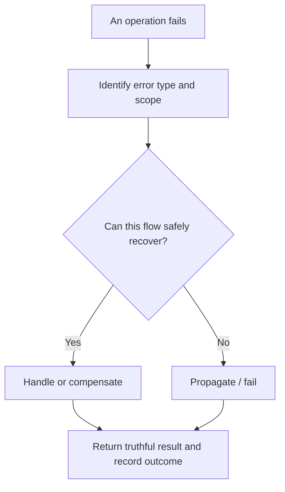
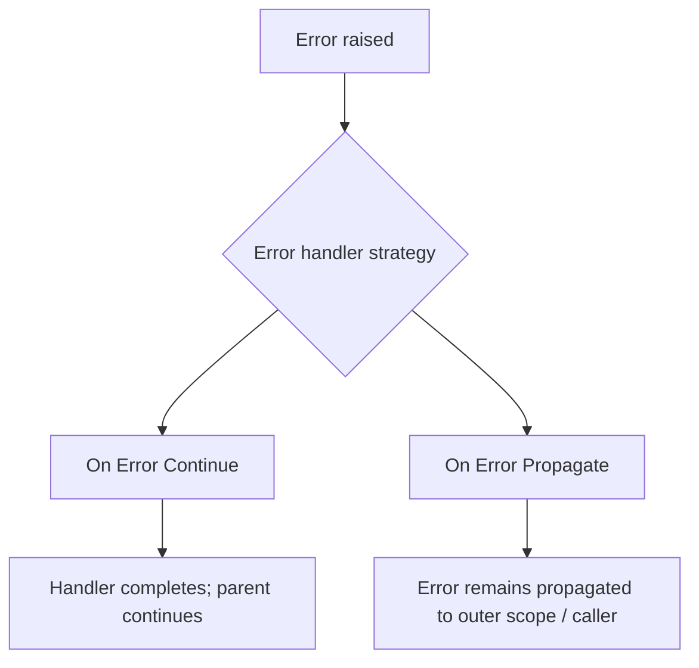

# Chapter 13.1 — Error Handling Fundamentals: Think in Decisions, Not in XML

Error handling becomes easier when you stop memorizing component names and ask four questions:

> **What failed? Where should it be handled? Can we recover? What should the caller or operator see?**

This chapter teaches the mental model first. The next lessons implement it in Mule 4.

## 1. The four-step memory rule: F-H-R-R

Remember **F-H-R-R**:

1. **Find** the failure: what operation failed and what error type was raised?
2. **Handle** it at the correct level: component/flow, or application-wide as appropriate.
3. **Recover or rethrow**: continue only if the flow can safely proceed; otherwise propagate the failure.
4. **Respond and record**: return a safe response, log useful context, and preserve traceability.



The objective is not to hide every error. The objective is to make failure predictable, observable, and safe.

## 2. What is a Mule error?

When a Mule event encounters a failure, Mule raises an error with structured information. Important concepts include:

- **Error type:** a namespace and identifier that classify the failure, such as an HTTP connectivity error or a validation error.
- **Description:** human-readable context about what went wrong.
- **Cause:** underlying exception details, when available.
- **Error handler:** logic that decides what to do with the failure.
- **Mule event:** the event being processed; the error handling context determines what state is available and what happens next.

Error type names are version/component-specific. Use Studio's error-type suggestions and the documentation for the connector version you actually use rather than guessing identifiers.

## 3. Where can errors be handled?

### On-error-continue

Use it when the failure has been intentionally handled and the parent flow can continue as a successful completion from the error handler's perspective.

Examples:
- A noncritical enrichment lookup fails, and the business rule explicitly permits a fallback.
- A request contains invalid input and the API deliberately returns a controlled client-error response.

Important: in a request/response API, you can intentionally build a 4xx response and complete the flow. This does not mean the original operation succeeded; it means the error was handled according to your API contract.

### On-error-propagate

Use it when the failure must remain a failure for the caller or outer scope.

Examples:
- A required payment authorization failed.
- A required database write did not complete.
- An order could not be safely persisted and the flow must not report success.



**Memory trick:** Continue = “I handled this; the parent can move on.” Propagate = “I cannot safely call this successful; pass the failure outward.”

The final HTTP status still depends on the listener's response/error-response configuration and the flow logic. Always test what the client actually receives.

## 4. Try scope vs flow-level error handler

- A **Try scope** is useful when only a specific set of operations needs local error handling, such as calling a payment provider and applying a targeted recovery rule.
- A **flow-level error handler** handles errors not handled within the relevant inner scope and is useful for consistent API or flow behavior.
- An **application default error handler** can provide a last-resort policy, but it should not replace deliberate business-specific handling.

Prefer the smallest scope that has enough context to make a correct decision. Avoid duplicating the same complicated handler in every flow; use reusable patterns where appropriate.

## 5. Error categories: a practical classification

| Category | Example | Typical action |
|---|---|---|
| Invalid client input | Missing order ID or malformed request | Return 400 with safe explanation |
| Not found | Requested customer does not exist | Return 404 if that matches the API contract |
| Business rule violation | Order exceeds allowed limit | Return a controlled 4xx response |
| Connectivity/transient dependency failure | Downstream service unavailable | Bounded retry where safe; otherwise 502/503/504-style response as appropriate |
| Authentication/authorization failure | Downstream rejects credentials | Do not retry blindly; alert/configure credentials and return a safe response |
| Unexpected internal error | Null assumption, coding bug | Return generic 500; log diagnostic details securely |

HTTP statuses are examples, not universal mappings. Follow your API contract and avoid revealing internal stack traces, secrets, hostnames, or tokens to clients.

## 6. A decision tree you can remember

When a component fails, ask:

1. **Is the request invalid?** Return a clear client error; do not retry.
2. **Is this an expected business outcome?** Handle it explicitly and return the documented outcome.
3. **Is the dependency temporarily unavailable?** Consider bounded retry only if the operation is safe to repeat.
4. **Could the operation already have succeeded?** Check idempotency or reconcile before retrying a side effect.
5. **Is this an unexpected bug?** Propagate appropriately, return a safe error, and log diagnostic context.

## 7. What makes a good error response?

A useful API error response is consistent and safe:

```json
{
  "errorCode": "ORDER_NOT_FOUND",
  "message": "The requested order was not found.",
  "correlationId": "abc-123"
}
```

Use a real correlation ID from the request/tracing context rather than hard-coding one. Consider whether the message is safe for external callers. Keep stack traces and internal exception details in protected logs, not public responses.

## 8. Common beginner mistakes

- Catching every error and returning HTTP 200.
- Using Continue when the business operation did not succeed.
- Retrying a non-idempotent payment or order creation without safeguards.
- Logging full payloads that contain passwords, tokens, or personal data.
- Treating every error as a 500.
- Swallowing an error without recording enough information to investigate.
- Assuming a timeout proves that the downstream side effect did not happen.

## Practice: classify these failures

For each scenario, choose: **handle and continue**, **propagate**, **retry safely**, or **return a controlled client error**.

1. Caller omits required `customerId`.
2. Product recommendation service is down, but recommendations are optional.
3. Payment authorization times out after the provider may have authorized it.
4. Required database write fails.
5. Caller asks for an order ID that does not exist.

Suggested reasoning: 1 and 5 are controlled client errors if the API contract says so; 2 may use a fallback if explicitly allowed; 3 requires reconciliation/idempotency, not a blind retry; 4 should not be reported as success.

## Official references

- [Mule 4 error handling](https://docs.mulesoft.com/mule-runtime/latest/intro-error-handling)
- [Mule error types](https://docs.mulesoft.com/mule-runtime/latest/mule-error-concept)
