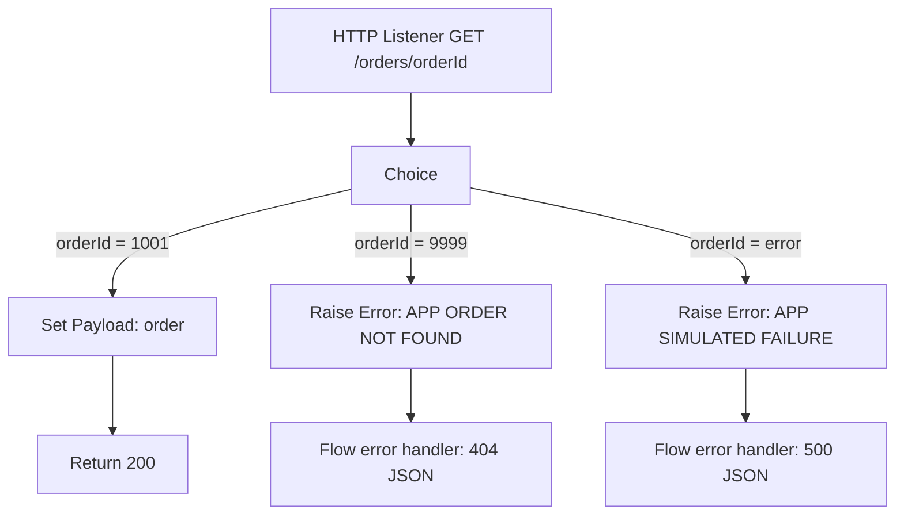

# Chapter 13.2 — Hands-On: Implement On-Error-Continue and On-Error-Propagate

In this lesson, build a tiny order API and deliberately cause errors. You will observe the difference between handling an error and allowing it to propagate.

## Goal

Create `GET /orders/{orderId}` with these outcomes:

| Request | Expected result |
|---|---|
| `GET /orders/1001` | 200 with order JSON |
| `GET /orders/9999` | 404 with a safe error body |
| `GET /orders/error` | Simulated internal failure; controlled 500 response |

This is a learning example using an in-memory condition—not a real database. The URI parameter and conditions are illustrative; adapt them to the component configuration in your Studio version.

## 1. Create the flow

1. Open Anypoint Studio and create a Mule project, for example `chapter13-error-handling`.
2. Add an HTTP Listener configuration on a local port such as `8081`.
3. Create a flow named `get-order-flow`.
4. Configure the Listener path as `/orders/{orderId}` and method as GET.
5. Add a Logger after the Listener to record that the request arrived. Do not log secrets or full sensitive payloads.
6. Add a Choice router to distinguish a known order, a not-found order, and a simulated error.

Conceptual flow:



## 2. Configure the Choice conditions

Use the URI parameter `attributes.uriParams.orderId`. Depending on the Listener configuration and Studio expression editor, the DataWeave expressions are:

- Known order: `attributes.uriParams.orderId == "1001"`
- Not found: `attributes.uriParams.orderId == "9999"`
- Simulated failure: `attributes.uriParams.orderId == "error"`

For a small lesson, use Set Payload for the known order:

```json
{
  "orderId": "1001",
  "status": "CONFIRMED",
  "total": 149.95
}
```

Set the response MIME type to `application/json` if needed. For any other ID, raise a custom application error using Studio's **Raise Error** component and a custom namespace/type such as `APP:ORDER_NOT_FOUND` or `APP:SIMULATED_FAILURE`. Create/select the custom error types in Studio as supported by your version; do not assume an undeclared type will be accepted.

## 3. Add a flow-level error handler

In the flow's Error handling section, add two On Error Continue scopes and match the appropriate custom error types.

### Handler A: not found

- Match `APP:ORDER_NOT_FOUND`.
- Set Payload to:

```json
{
  "errorCode": "ORDER_NOT_FOUND",
  "message": "The requested order was not found."
}
```

- Configure the HTTP Listener's error response/status handling so this handled branch returns **404**. Verify the actual response in your version; a handled error does not automatically guarantee the desired HTTP status without correct listener response configuration.

### Handler B: simulated failure

- Match `APP:SIMULATED_FAILURE`.
- Set Payload to a generic error body:

```json
{
  "errorCode": "INTERNAL_ERROR",
  "message": "The request could not be completed."
}
```

- Configure the Listener's error response/status to **500** for this branch, and log safe diagnostic information on the server side.

**Why Continue?** The flow deliberately handles the failure and returns a defined response. The business request still failed, but the API response is controlled.

## 4. Observe On-Error-Propagate

Now create a second flow or temporarily change the not-found handler to **On Error Propagate**.

1. Use the same Raise Error component.
2. Add an On Error Propagate handler for `APP:ORDER_NOT_FOUND`.
3. Do not set a successful order payload.
4. Configure the Listener's error-response body/status appropriately, or allow the application's standard error response to apply.
5. Test `/orders/9999` again.

With Propagate, the error remains a failure and is passed outward. A flow-level propagate handler generally does not continue normal processing after the error. The final status/body depends on the listener's error response configuration and any outer/default handler.

## 5. Test with curl or Postman

Start the application, then run:

```bash
curl -i http://localhost:8081/orders/1001
curl -i http://localhost:8081/orders/9999
curl -i http://localhost:8081/orders/error
```

Expected:
- First request: HTTP 200 and order JSON.
- Second request: HTTP 404 and a safe `ORDER_NOT_FOUND` body when the Listener response is configured accordingly.
- Third request: HTTP 500 and a generic internal error body when configured accordingly.

If the status differs, inspect the Listener's Response and Error Response tabs and the error handler. Do not assume the payload alone sets the HTTP status.

## 6. Remember it

- **Continue:** the error handler has intentionally handled the error; normal parent-flow completion can proceed.
- **Propagate:** keep the failure visible to the outer scope/caller.
- **Raise Error:** deliberately create a business/application error when a condition is not acceptable.
- **Set Payload:** shapes the response body; the HTTP status must also be configured.
- **Logger:** record safe diagnostic context for investigation.

## Troubleshooting

| Symptom | Check |
|---|---|
| Custom error type is rejected | Define/select the custom type in Studio and check its namespace |
| Client receives 200 for an error body | Configure the Listener's response status; body and status are separate |
| Handler never runs | Confirm the error type match and whether the error is raised inside the expected scope |
| Client sees stack trace or internal details | Configure a safe error response and keep diagnostics in protected logs |
| Error is swallowed | Review Continue/Propagate choice and whether a fallback is genuinely valid |

## Practice challenge

Add `GET /customers/{customerId}`:
- Known ID returns a customer.
- Unknown ID returns 404 with a stable error schema.
- Simulated backend failure returns 503 or another documented dependency-failure status.
- Every error response includes a correlation ID.
- No response exposes a stack trace.

## Official references

- [Mule 4 error handling](https://docs.mulesoft.com/mule-runtime/latest/intro-error-handling)
- [Raise Error component](https://docs.mulesoft.com/mule-runtime/latest/raise-error-component-reference)
- [HTTP Listener reference](https://docs.mulesoft.com/http-connector/latest/http-listener-ref)
