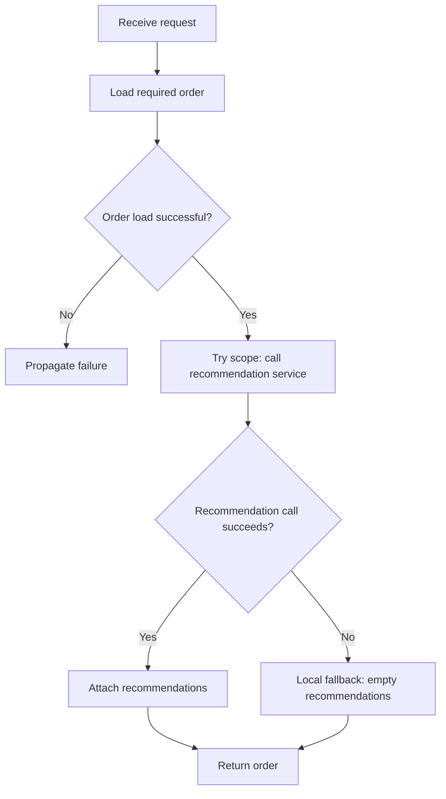

# Chapter 13.3 — Try Scope, Error Types, and Choosing the Right Handler

A good error handler lives where the system has enough information to make the right decision. This lesson shows how to handle a local failure without hiding unrelated errors.

## 1. The Try-scope pattern

Imagine an order API that calls an optional product-recommendation service. If recommendations fail, the order can still be returned with an empty recommendation list. But if the required order database write fails, the API must not pretend the order was saved.



The Try scope groups the operation and its local error handling. Place only the operations that share the same recovery policy inside it.

## 2. Build the optional-enrichment example

1. Create a flow `GET /products/{productId}`.
2. Fetch or construct the required product details.
3. Add a Try scope around only the optional HTTP Request to the recommendation service and the transformation that depends on that response.
4. Configure a local On Error Continue for the expected connectivity failure supported by the connector/version.
5. In the handler, set a fallback variable such as `recommendations = []`, or otherwise preserve a valid product response with no recommendations.
6. Outside the Try scope, build the final response.

Pseudocode:

```text
Load required product
Try:
    Call recommendation service
    Transform recommendation response
On expected optional-service error:
    Set recommendations to []
Build final product response
```

This is intentionally pseudocode rather than connector XML: connection settings and exact error types depend on the HTTP Request and runtime versions in your project.

## 3. Do not catch too broadly

Avoid catching every error and returning a fallback. A transformation bug, invalid credentials, malformed data, and a network timeout are different failures.

Use this hierarchy:
1. Handle a specific expected error where recovery is safe.
2. Let unexpected errors propagate.
3. Use a flow-level handler for API-wide formatting and logging.
4. Use an application default only for last-resort behavior, not to replace business logic.

A broad catch-all can be appropriate for a final safe response boundary, but it must still preserve diagnostics, return a truthful failure status, and avoid masking defects.

## 4. Error type matching

Mule errors are categorized by types. Common connector namespaces may include HTTP, DB, JMS, and others, but exact type names depend on the component and version. Use Studio autocomplete and the relevant connector reference.

Do not match only the text of an error description if a structured error type is available. Descriptions can change and may contain implementation-specific details.

When designing a handler, document:
- Which error types it handles.
- Why those failures are recoverable.
- What fallback or compensation occurs.
- Which failures should propagate.
- What the client sees and what gets logged.

## 5. Scope and propagation mental model

Think of nested scopes like a building with rooms:
- A local Try handler is a nearby exit for a known problem.
- If the local handler does not match or propagates the error, the error can travel outward.
- The flow-level handler is the next place to apply the API's policy.
- The outer/default handler is a final boundary.

The precise runtime behavior depends on handler type and scope; verify the flow with tests rather than relying only on the metaphor.

## 6. Real-world example: payment provider timeout

Do **not** use an empty fallback for payment authorization. A timeout can mean the provider completed the authorization but the response was lost.

Safer approach:
1. Include a unique idempotency key in the payment request if the provider supports it.
2. On timeout, mark the payment result as `UNKNOWN` or pending.
3. Query the provider or reconcile using its supported mechanism.
4. Retry only according to the provider's idempotency and retry guidance.
5. Do not confirm the order until the payment outcome meets the business rule.

This is an example of choosing the correct error strategy based on business risk, not merely based on the error name.

## 7. Practice challenge

Design handlers for these cases:
- Optional currency-rate lookup fails: can a documented fallback be used?
- Required customer database lookup fails: should the API report success?
- Payment request times out: can you safely retry immediately?
- Request body is malformed: should you retry the same body?

For each, state the error type/category, handler scope, Continue/Propagate choice, client status, and logging policy.

## Official references

- [Mule 4 error handling](https://docs.mulesoft.com/mule-runtime/latest/intro-error-handling)
- [Try scope](https://docs.mulesoft.com/mule-runtime/latest/try-scope-concept)
