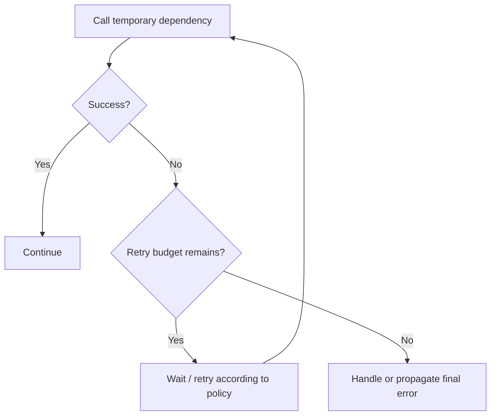
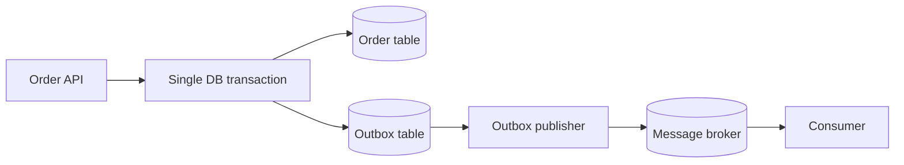

# Chapter 13.4 — Retries, Transactions, and Production Error Handling

Retries can improve resilience—but a retry is another attempt at an operation, not a guarantee that the previous attempt did nothing. This lesson explains how to retry safely and how to operate failures in production.

## 1. The retry decision

Before retrying, ask three questions:

1. Is the error likely temporary?
2. Is the operation safe to repeat?
3. Is there a limit and a way to observe final failure?

| Situation | Typical approach |
|---|---|
| Temporary network failure on an idempotent read | Bounded retry may help |
| HTTP 400 due to invalid input | Do not retry unchanged request |
| Invalid credentials | Fix configuration; repeated retry adds noise |
| Payment timeout with unknown outcome | Reconcile or use provider idempotency before retry |
| Database deadlock | A bounded retry may be appropriate if transaction and operation semantics support it |
| Message processing repeatedly fails | Use broker/connector redelivery policy and dead-letter handling |

Use bounded retry with backoff where supported. Avoid infinite tight loops. Configure the timeout budget for the whole request, not only each individual attempt.

## 2. Mule Retry Scope

Mule 4 provides a Retry Scope for repeating enclosed processing when a failure occurs, according to its configured retry policy. Exact configuration options and interaction with transactions should be checked against the Mule Runtime version.

Conceptual design:



Do not assume every connector operation can be safely retried. Side effects such as charging a card, creating a shipment, or submitting a purchase order need idempotency and reconciliation.

## 3. Retry vs redelivery vs replay

These terms are related but different:

- **Retry:** the application repeats an operation after an error.
- **Message redelivery:** a broker/connector delivers an unacknowledged or failed message again according to its policy.
- **Replay:** an operator or process deliberately resubmits a previously failed message or event.

Each can produce duplicate business effects unless the consumer is idempotent. Define who owns retries, where retry state lives, and how operators can safely replay a dead-letter message.

## 4. Transactions: what they do and do not promise

A transaction can coordinate supported operations within its configured transactional boundary. It does not automatically create one atomic transaction across an arbitrary HTTP service, a database, and an external broker.

For example, saving an order in a database and publishing an event can fail between the two steps. A robust pattern is the **transactional outbox**:
1. In one database transaction, save the order and an outbox record.
2. A separate publisher reads unsent outbox records and publishes them.
3. Mark publication status after success, using safe deduplication.
4. Monitor stuck records and reconcile.



The outbox reduces the risk of an order being saved without an event record. Publication and consumption still need duplicate-safe design.

## 5. Production error response pattern

For an API, standardize:
- A stable error code.
- A client-safe message.
- A correlation/trace ID.
- The appropriate HTTP status.
- No stack traces, secrets, or internal system details in the public body.

Example:

```json
{
  "errorCode": "DEPENDENCY_UNAVAILABLE",
  "message": "The request cannot be completed right now.",
  "correlationId": "use-the-real-request-correlation-id"
}
```

Map statuses based on your API contract. A dependency timeout might warrant 504; an unavailable service might warrant 503; a gateway failure may warrant 502. These are design choices to document, not universal automatic mappings.

## 6. Logging and observability

A production handler should record enough information to investigate:
- Correlation ID / trace ID.
- Flow and operation name.
- Error type and safe error summary.
- Business identifier where permitted.
- Retry count or delivery attempt where available.
- Final outcome and elapsed time.

Never log access tokens, passwords, full payment details, or unredacted sensitive payloads. Use structured logs and metrics. Alert on sustained error rate, queue backlog, old messages, dead-letter volume, and latency—not merely on every individual failure.

## 7. Practical test matrix

Test more than the happy path:

| Test | Expected design outcome |
|---|---|
| Valid request | Success response |
| Invalid request | Controlled 4xx, no retry |
| Dependency unavailable | Bounded retry if safe; otherwise controlled failure |
| Retry budget exhausted | Clear final error, traceable logs |
| Duplicate message | No duplicate business effect |
| Consumer crash after side effect | Safe redelivery / deduplication strategy |
| Broker unavailable | Durable recovery plan; do not claim message accepted |
| Poison message | Dead-letter route, alert, controlled replay |
| Sensitive exception | Client sees safe message; diagnostic detail stays protected |

## 8. Practice challenge

Your Mule application receives an order and publishes a message:
- Design the response when the broker is unavailable.
- Decide whether the API can still return 202.
- Explain how you prevent the database write and publish from becoming inconsistent.
- Decide how the consumer handles redelivery.
- Specify the dead-letter workflow and alert.

## Chapter 13 final memory card

- **Find** the failure and identify its type.
- **Handle locally** only when the business rule allows recovery.
- **Continue** when the error is intentionally handled; **Propagate** when the failure must remain visible.
- **Retry** only when temporary and safe, with a limit.
- **Protect** the caller from internal details while logging enough to investigate.
- **Test** failure paths, duplicates, and recovery—not only successful requests.

## Official references

- [Mule 4 error handling](https://docs.mulesoft.com/mule-runtime/latest/intro-error-handling)
- [Mule Retry Scope](https://docs.mulesoft.com/mule-runtime/latest/retry-scope-concept)
- [Mule HTTP Listener reference](https://docs.mulesoft.com/http-connector/latest/http-listener-ref)
