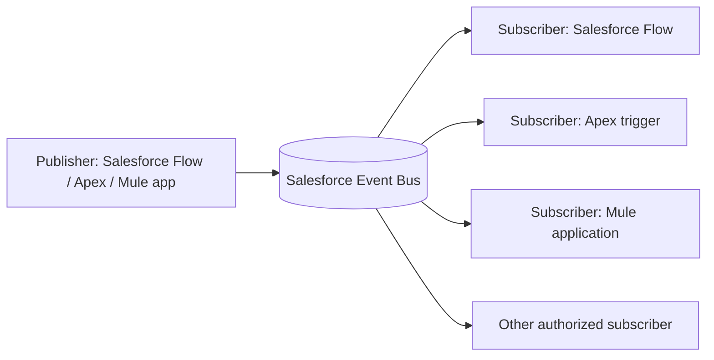
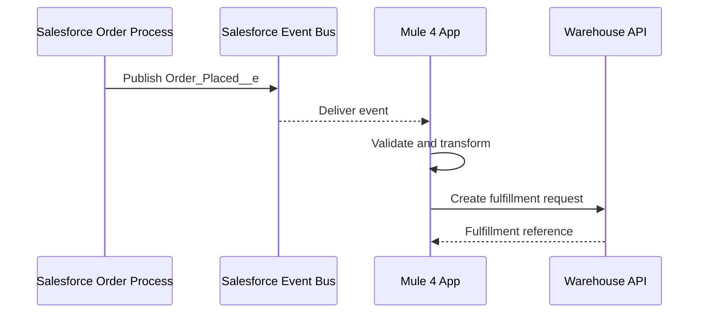

# Chapter 14.1 — Platform Events: Fundamentals and Architecture

In this chapter, **Platform Events means Salesforce Platform Events**—Salesforce's event-driven messaging feature. They are different from MuleSoft Anypoint MQ messages, JMS messages, and Salesforce Change Data Capture (CDC) events.

## 1. The easiest way to understand an event

Think of a restaurant order:

- A request says: “Tell me the current status of order 123.”
- An event says: “Order 123 has just been placed.”

A request asks another system to do something or return information. An event announces that something happened. Other systems can react without the publisher needing to know who they are.

A Salesforce Platform Event is a custom, schema-defined message published to Salesforce's event bus. Subscribers can include Salesforce Flows, Apex triggers, and external applications using supported APIs/connectors.

## 2. Event-driven architecture

**Remember:** publisher announces; event bus distributes; subscribers react.

The publisher and subscribers are decoupled: the publisher does not need to call each subscriber directly. Multiple subscribers can respond to the same event independently.

## 3. Platform Event vs a Salesforce record vs CDC

| Concept | What it means | Example |
|---|---|---|
| Salesforce record | Current stored business data | An Account or Order record |
| Platform Event | A custom business fact/message published for subscribers | `Order_Placed__e` |
| Change Data Capture (CDC) | An event describing a change to a Salesforce record | An Account record was updated |
| Anypoint MQ message | A message sent through MuleSoft's managed messaging service | A background job is queued |
| JMS message | A message handled through a compatible JMS provider/API | A Java application consumes a queue |

Use a **Platform Event** when you want to define a custom event contract, such as `Order_Placed__e`. Use **CDC** when the requirement is to react to Salesforce record changes and the relevant object is supported. Do not choose Platform Events merely because the word “event” appears in the requirement.

## 4. A real-time order example

When an order is confirmed in Salesforce, publish `Order_Placed__e` with fields such as:
- `Order_Number__c`
- `Customer_Reference__c`
- `Total_Amount__c`
- `Event_Created_At__c`

Then:
- A Salesforce Flow sends a confirmation task.
- MuleSoft receives the event and calls an external fulfillment API.
- An analytics service records a business metric.

This is asynchronous. Publishing the event does not mean the warehouse has finished processing it. If the publisher needs to know the final fulfillment result, design a separate status update or response path.

## 5. Event schema and naming

A custom Platform Event API name ends in `__e`. For example, an event with object name `Order_Placed` has API name `Order_Placed__e`; a subscription channel is commonly `/event/Order_Placed__e`.

Design the schema before building the integration:
- Use clear field names and documented meanings.
- Include a business identifier such as an order number.
- Include an event version or schema evolution strategy where useful.
- Send only the data subscribers actually need.
- Avoid credentials, tokens, and unnecessary personal data.
- Treat published event messages as immutable facts; they are not normal records that users update or delete.

## 6. Publish behavior: immediate vs after commit

When defining a custom Platform Event, Salesforce provides publish behavior choices:
- **Publish Immediately:** the event is published when the publish call executes; a subscriber may receive it before the publishing transaction commits.
- **Publish After Commit:** the event is published only after the publishing transaction commits successfully. Choose this when subscribers depend on data written in that transaction.

For example, if Mule receives an event and immediately queries the newly created Salesforce order, After Commit may be the safer choice. Pick the behavior based on the consistency requirement, not habit.

## 7. Delivery, replay, and limitations

Salesforce event delivery is not the same as a permanent message queue. Event messages are retained for a limited window, and subscribers can use supported replay mechanisms to recover missed messages within that window. Replay IDs are opaque positions in the stream—do not calculate a replay ID by adding or subtracting values.

Build consumers to tolerate duplicate processing and to handle disconnections. Monitor subscription health and event usage. Confirm current limits, retention, supported editions, and API access for your Salesforce org.

## 8. When should you use Platform Events?

Use them when:
- Salesforce needs to notify one or more systems that a business event occurred.
- Producers and subscribers should be decoupled.
- You need near-real-time reactions rather than repeated polling.
- Several independent subscribers need the same event.

Consider a direct API call when the caller needs an immediate response. Consider CDC when you specifically need supported record-change notifications. Consider Anypoint MQ or another broker when the message workflow belongs in that messaging platform.

## Practice challenge

A sales team confirms an order in Salesforce. Design an event that allows a Mule application and a Salesforce Flow to react independently. Write:
1. The event API name.
2. Three or four event fields.
3. Which publish behavior you would choose and why.
4. What should happen if Mule is temporarily offline.
5. How to prevent duplicate fulfillment.

## Official references

- [Salesforce Platform Events Developer Guide](https://developer.salesforce.com/docs/platform/platform-events/guide/platform-events-intro.html)
- [Define and Manage Platform Events](https://help.salesforce.com/s/articleView?id=platform.platform_events.htm&language=en_US&type=5)
- [Salesforce event-driven architecture](https://developer.salesforce.com/docs/platform/platform-events/guide/platform-events-intro-architecture.html)
- [Platform Events vs CDC: Salesforce API guidance](https://help.salesforce.com/s/articleView?id=platform.integrate_what_is_api.htm&language=en_US&type=5)
