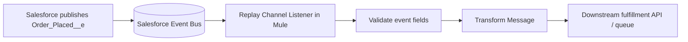

# Chapter 14.3 — Hands-On: Subscribe to Salesforce Platform Events from Mule 4

Now connect Salesforce to MuleSoft. The Mule application will subscribe to `Order_Placed__e`, log safe event details, and prepare the payload for a downstream system.

There are Salesforce connector options with different capabilities. This lesson shows the **Salesforce Connector Replay Channel Listener** approach documented by MuleSoft. Verify your connector version and supported runtime before building the flow.

## Architecture



## 1. Prerequisites

- A Salesforce org with the `Order_Placed__e` event from subchapter 14.2.
- Anypoint Studio and a Mule 4 runtime supported by your Salesforce Connector version.
- Salesforce API access and an integration user/connected app configured according to your organization's authentication requirements.
- Permission to subscribe to the Platform Event.
- Access to the event schema and the connector's current documentation.

Do not commit client secrets, usernames/passwords, or tokens to Git. Use secure configuration and your organization's credential-management process.

## 2. Create a Mule application

1. Open Anypoint Studio and create a Mule project, for example `platform-events-subscriber`.
2. Add the Salesforce Connector from Exchange through Studio's connector dependency workflow.
3. Configure Salesforce authentication according to the current connector version and your organization's supported authentication method.
4. Test the global Salesforce configuration.
5. Create a flow with a Salesforce **Replay Channel Listener** source.

In the Streaming Channel field, enter:

```text
/event/Order_Placed__e
```

The channel name must match the actual event API name. For a custom Platform Event, the channel typically uses `/event/{EventApiName__e}`.

## 3. Add a Logger

After the listener, add a Logger to confirm the event arrives. During a controlled learning test, log only a few non-sensitive fields, such as order number and event type. Avoid logging entire payloads in production.

Conceptual flow:

```xml
<flow name="order-placed-subscriber">
    <!-- Configure the Salesforce Replay Channel Listener in Studio -->
    <logger level="INFO"
            message="Received Order_Placed event; processing event payload"/>
    <!-- Add validation, transformation, and downstream processing -->
</flow>
```

This XML is a structural illustration, not a complete deployable flow. The source element's exact XML attributes depend on the Salesforce Connector version and the configuration generated by Studio. Prefer generating the component in Studio instead of copying an incomplete snippet.

## 4. Test the subscription

1. Start the Mule application and confirm that the Salesforce connection succeeds.
2. Publish a new `Order_Placed__e` event in Salesforce using subchapter 14.2.
3. Watch the Mule console for the listener and Logger output.
4. Publish another event with a different order number.
5. Confirm each event is processed by the expected flow.

If no event arrives, check the channel name, connector configuration, permissions, API access, event publish result, and Mule logs. Make sure the subscription is active before publishing test messages.

## 5. Understand replay behavior

A replay-capable listener can subscribe according to the connector's supported replay options. Replay IDs identify positions in the event stream; treat them as opaque values and do not calculate them. Salesforce event retention is limited, so replay cannot recover messages that have expired from the event bus.

For a production integration:
- Select a replay strategy appropriate to the business requirement.
- Understand whether a restart resumes from stored position or starts from the latest available events.
- Persist processing state only as supported by your connector/application design.
- Make downstream effects idempotent to tolerate duplicate delivery.
- Monitor disconnects and missed-event risk.

Do not assume that every event connector configuration provides permanent storage or exactly-once business processing.

## 6. Transform the event

Add Transform Message after the listener and map the event into the schema expected by your downstream API. The exact input structure shown by Studio's metadata depends on the connector and event schema. Use the DataWeave input metadata from the actual flow rather than assuming the payload wrapper shape.

Illustrative target JSON:

```json
{
  "orderNumber": "ORD-10045",
  "customerReference": "C-204",
  "totalAmount": 149.95,
  "source": "Salesforce"
}
```

Map from the received event fields to this target shape. Validate required values before invoking the downstream service. If a field is absent or malformed, use the Chapter 13 error-handling patterns.

## 7. Production-ready next steps

After the first event arrives successfully:
1. Add schema validation.
2. Add a correlation/business ID to logs.
3. Call the fulfillment API or publish to a downstream broker.
4. Design error handling and retry behavior.
5. Make the operation idempotent using the order number or a durable deduplication key.
6. Monitor subscription health, processing latency, and failures.
7. Keep secrets and sensitive data out of logs.

## Troubleshooting checklist

- Does the event exist and use the exact `__e` API suffix?
- Is the channel `/event/Order_Placed__e`?
- Can the configured Salesforce user subscribe to the event?
- Does the connector version support the runtime and authentication method?
- Is the event actually being published?
- Is the Mule app connected before the test event is published?
- Is the event within the available retention window?

## Official references

- [MuleSoft: Process events with Salesforce Connector](https://docs.mulesoft.com/salesforce-connector/latest/salesforce-connector-processing-events)
- [Salesforce Help: Subscribe to Platform Events with Mule 4](https://help.salesforce.com/s/articleView?id=001116948&language=en_US&type=1)
- [Salesforce Connector documentation](https://docs.mulesoft.com/salesforce-connector/latest/)
