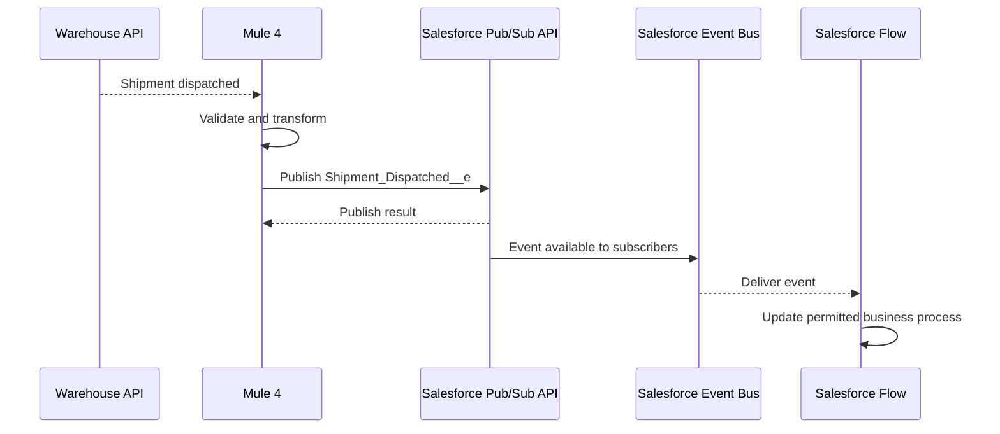
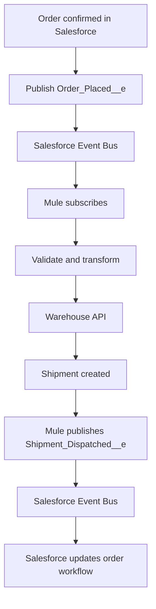

# Chapter 14.4 — Publish Platform Events from Mule and Build an End-to-End Integration

Subchapter 14.3 received an event from Salesforce. This lesson looks at the reverse direction: Mule publishes an event to Salesforce, and then combines both directions into an event-driven integration.

## 1. Choose the right connector

MuleSoft offers a Salesforce Connector and a Salesforce Pub/Sub Connector. They are related but not interchangeable:
- **Salesforce Connector** includes operations for working with Salesforce data and documented event-streaming features such as replay-channel subscription.
- **Salesforce Pub/Sub Connector** uses Salesforce's Pub/Sub API to publish and subscribe to supported high-volume Platform Events and Change Data Capture events, and to work with schemas/topics.

Confirm the current connector version, runtime compatibility, supported event types, and authentication requirements. For custom Platform Events, topic/channel formats commonly use `/event/EventName__e`.

## 2. Example: Mule publishes an order status event

Suppose Mule receives a fulfillment result from an external warehouse. It should notify Salesforce that the shipment was dispatched.

Example event: `Shipment_Dispatched__e`

Possible fields:
- `Order_Number__c`
- `Shipment_Number__c`
- `Carrier__c`
- `Dispatch_Time__c`

The flow is:

The event publish result is distinct from successful execution of the subscriber's logic. Monitor the publisher and subscriber separately.

## 3. Implementation outline in Anypoint Studio

1. Define `Shipment_Dispatched__e` and its fields in Salesforce Setup.
2. Add Salesforce Pub/Sub Connector to your Mule project through Studio/Exchange.
3. Configure the connection and permissions using the current connector guide.
4. Add a flow whose source receives the warehouse result (for example, an HTTP Listener or an HTTP Request response).
5. Validate the required order and shipment identifiers.
6. Add the connector's **Publish Event** operation and select the topic for `Shipment_Dispatched__e` using the topic format documented by your connector version.
7. Map the event payload using the schema and input/output metadata surfaced by the connector.
8. Inspect the publish result and route failures to an appropriate error handler.
9. Create a Salesforce subscriber, such as a Platform Event-triggered Flow, to react to the event.
10. Test with a non-production Salesforce org and a known sample shipment.

The exact connector field names and payload wrapper depend on the installed version. Use Studio's generated configuration and the current reference rather than copying a guessed XML fragment.

## 4. End-to-end use case: order-to-shipment

This design avoids a direct synchronous call from Salesforce to every downstream consumer. However, it creates an asynchronous workflow: order confirmation and shipment dispatch occur at different times. Track the business state so support teams can tell whether an order is waiting, processing, dispatched, or failed.

## 5. Reliability and error handling

Use the Chapter 13 patterns:
- Validate required event fields before making downstream calls.
- Retry transient failures only when safe.
- Use idempotency so a repeated `Order_Placed__e` does not create duplicate shipments.
- Capture event/business identifiers and correlation IDs.
- Distinguish “publish accepted” from “business process completed.”
- Plan how to recover events missed during an outage within Salesforce's retention window.
- Alert on disconnected subscriptions, processing failures, and stalled orders.
- Do not assume event publication, Salesforce record updates, and an external API call share one atomic transaction.

For business-critical flows, add a durable status record or reconciliation job so operators can find orders that have not progressed.

## 6. Platform Events vs Anypoint MQ: which should carry the message?

| Requirement | Likely starting point |
|---|---|
| Notify Salesforce automation and external subscribers about a custom business event | Salesforce Platform Events |
| Detect changes to Salesforce records | Change Data Capture, if the object/change requirement is supported |
| Buffer background work between Mule applications | Anypoint MQ or another appropriate broker |
| Call a system and wait for an immediate result | HTTP/API request-response |
| Let several independent consumers react to one business fact | Event/pub-sub pattern, with a platform selected to fit the consumers |

These options can be combined. For example, Mule can subscribe to a Salesforce Platform Event, process it, and then publish a message to Anypoint MQ for downstream workers.

## 7. Capstone challenge

Build or document an order integration with:
1. `Order_Placed__e` published from Salesforce.
2. Mule 4 subscription using a supported Salesforce connector.
3. Validation and DataWeave transformation.
4. A mock fulfillment endpoint or a test service.
5. `Shipment_Dispatched__e` published back to Salesforce.
6. A Salesforce subscriber that records or displays the new shipment status.
7. Error handling, idempotency, correlation IDs, replay strategy, and monitoring.

### Acceptance criteria

- Mule receives a test event from Salesforce.
- Invalid event data is handled safely.
- A valid event produces exactly one intended business effect even if the event is redelivered.
- Mule can publish the downstream status event.
- The Salesforce subscriber reacts to the status event.
- Logs identify the order without exposing secrets.
- The design explains retention, replay, retry, and reconciliation limits.

## Final memory card

- **Platform Event:** custom business fact published by Salesforce.
- **Event Bus:** distributes event messages to eligible subscribers.
- **Publisher:** sends the event.
- **Subscriber:** reacts to the event.
- **Replay:** resumes from a supported event-stream position within retention.
- **Mule integration:** subscribes, validates, transforms, and routes—or publishes an event back to Salesforce.
- **Idempotency:** prevents duplicate business effects when processing is repeated.

## Official references

- [Salesforce Pub/Sub Connector](https://docs.mulesoft.com/salesforce-pubsub-connector/latest/)
- [Salesforce Pub/Sub Connector reference](https://docs.mulesoft.com/salesforce-pubsub-connector/latest/salesforce-pubsub-connector-reference)
- [Salesforce Platform Events: Publishing](https://developer.salesforce.com/docs/platform/platform-events/guide/platform-events-publish.html)
- [Salesforce Platform Events: Subscribing](https://developer.salesforce.com/docs/platform/platform-events/guide/platform-events-subscribe.html)
- [MuleSoft Salesforce Connector: Processing events](https://docs.mulesoft.com/salesforce-connector/latest/salesforce-connector-processing-events)
