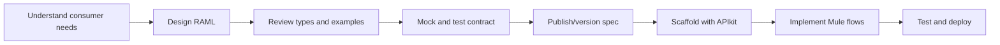

# 15.1 — RAML Fundamentals and API Design

## Learning objectives

By the end, you should be able to explain RAML, read a RAML 1.0 file, design resources and methods, select parameters, document status codes, and distinguish an API contract from a running Mule application.

## 1. What is RAML?

**RAML** means **RESTful API Modeling Language**. RAML 1.0 is a YAML-based language for describing HTTP APIs: resources, methods, parameters, request and response bodies, types, examples, and security schemes. It is an API contract, not the implementation itself.

Official specification: [RAML 1.0](https://github.com/raml-org/raml-spec/blob/master/versions/raml-10/raml-10.md).

## 2. Contract-first lifecycle



## 3. RAML vs related technologies

| Technology | Purpose |
|---|---|
| YAML | Data serialization syntax; RAML uses YAML syntax plus RAML-specific rules |
| JSON | Common API request/response payload format |
| RAML | Describes API contract and expected behavior |
| OpenAPI (OAS) | Another widely used API-description specification |
| DataWeave | Transforms and maps data at Mule runtime |
| APIkit | Helps scaffold REST API flows from a supported API specification |

RAML and OpenAPI are alternatives for describing APIs. Follow project standards and tool support rather than assuming one format is always superior.

## 4. Minimal RAML file

```yaml
#%RAML 1.0
title: Library API
version: v1
baseUri: https://api.example.com/{version}
mediaType: application/json
```

- `#%RAML 1.0` identifies the RAML version.
- `title` names the API.
- `version` documents the API version; it does not automatically route traffic.
- `baseUri` declares the base URI. Use an appropriate environment host in real deployments.
- `mediaType` declares the default body media type.

YAML indentation matters. Use spaces, not tabs.

## 5. Resources and HTTP methods

Resources should normally be nouns, often plural:

| Endpoint | Method | Typical meaning | Common success status |
|---|---|---|---|
| `/books` | GET | List books | 200 |
| `/books` | POST | Create a book | 201 |
| `/books/{bookId}` | GET | Retrieve one book | 200 |
| `/books/{bookId}` | PATCH | Partially update a book | 200 or 204 |
| `/books/{bookId}` | DELETE | Delete a book | 204 |

Avoid action-oriented paths such as `/createBook` when a resource and HTTP method express the intent clearly.

## 6. URI parameters and query parameters

A URI parameter identifies a resource:

```yaml
/books/{bookId}:
  uriParameters:
    bookId:
      type: string
      minLength: 1
  get:
    responses:
      200:
        body:
          application/json:
            type: Book
```

Query parameters usually filter or control a collection:

```yaml
/books:
  get:
    queryParameters:
      q?:
        type: string
      limit?:
        type: integer
        minimum: 1
        maximum: 100
        default: 20
```

Example: `GET /books/b-101` identifies a book; `GET /books?q=mule&limit=10` searches a collection.

## 7. Request bodies, responses, and statuses

A request body describes what the caller sends. A response body describes what the API returns.

```yaml
/books:
  post:
    body:
      application/json:
        type: NewBook
    responses:
      201:
        body:
          application/json:
            type: Book
      400:
        body:
          application/json:
            type: Error
```

Common statuses: **200** success, **201** created, **204** success without a response body, **400** invalid request, **401** unauthenticated, **403** forbidden, **404** not found, **409** conflict, **415** unsupported media type, **429** rate limited, **500** unexpected server error, and **503** temporarily unavailable.

Document statuses that the API actually intends to return.

## 8. Types and examples

```yaml
types:
  Book:
    type: object
    properties:
      id: string
      title: string
      author: string
      price:
        type: number
        minimum: 0
      inStock: boolean
  Error:
    type: object
    properties:
      code: string
      message: string

/books/{bookId}:
  get:
    responses:
      200:
        body:
          application/json:
            type: Book
            example:
              id: b-101
              title: MuleSoft Basics
              author: A. Learner
              price: 29.99
              inStock: true
      404:
        body:
          application/json:
            type: Error
            example:
              code: BOOK_NOT_FOUND
              message: No book exists for this id.
```

Examples should match declared types and use synthetic, non-sensitive data.

## 9. Design checklist

- Identify consumers and business purpose.
- Use predictable resource names and HTTP methods.
- Define required vs optional properties intentionally.
- Type and bound parameters.
- Document success and failure responses.
- Include representative examples.
- Document security expectations.
- Consider pagination, filtering, compatibility, and versioning.
- Never place real credentials or sensitive data in examples.

## Practice set

1. Design `GET /customers/{customerId}` with a required string parameter, a Customer response, and a documented 404 Error response.
2. Design `POST /orders` with a JSON request body and 201, 400, and 409 responses.
3. Explain why returning `200 OK` with an error message for a missing resource is usually less clear than documenting a 404.
4. Explain the difference between RAML, a Mule flow, and a DataWeave transformation.

## Official references

- [RAML 1.0 specification](https://github.com/raml-org/raml-spec/blob/master/versions/raml-10/raml-10.md)
- [Anypoint Code Builder API specs](https://docs.mulesoft.com/anypoint-code-builder/des-designing-api-specs)
- [API Designer guide](https://docs.mulesoft.com/design-center/design-create-publish-api-specs)
