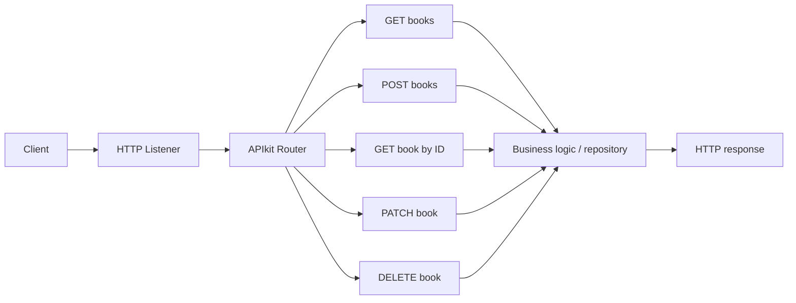

# 15.5 — Implement RAML with APIkit in Mule 4

**Goal:** Turn a reviewed RAML contract into Mule flows, implement each operation, and test runtime behavior.

APIkit scaffolding generates an implementation skeleton from an API specification. It does not automatically implement persistence, business rules, downstream calls, authorization, or production monitoring.

Official reference: [APIkit REST scaffolding](https://docs.mulesoft.com/apikit/latest/apikit-4-scaffolding-reference).

## 1. Prerequisites

- A working Anypoint Studio and supported Mule runtime.
- APIkit version compatible with the runtime/project.
- A valid RAML 1.0 specification.
- Postman or curl.
- A defined strategy for data storage (static sample data is acceptable only for an introductory exercise).

## 2. Scaffold the API

Exact menu labels vary by Studio version, but the typical process is:

1. Create a Mule project or import the API specification.
2. Add the RAML entry-point file and its referenced fragments/examples.
3. Use the supported API scaffolding or project wizard option to generate flows.
4. Select the correct specification and compatible APIkit dependency.
5. Inspect the generated listener, APIkit Router, console flow (if generated), and action flows.
6. Run the application and confirm the configured base path.

Do not assume flow names, ports, or path prefixes are identical across projects; verify your generated configuration.

## 3. Architecture



## 4. Implement vertical slices

Implement and test one endpoint at a time:

1. GET collection with a known sample collection.
2. GET item with a documented not-found response.
3. POST creation with a unique ID and a 201 response.
4. PATCH with explicit partial-update behavior.
5. DELETE with a 204 response when successful.

An in-memory example may reset when the application restarts. Use a database or a deliberately designed external repository for durable production data.

## 5. Test with curl

Assuming the listener is configured on port 8081 and the base path is `/api` (both are examples—verify your project):

```bash
curl -i http://localhost:8081/api/books
curl -i http://localhost:8081/api/books/b-101
curl -i -X POST http://localhost:8081/api/books \
  -H 'Content-Type: application/json' \
  -d '{"title":"MuleSoft Basics","author":"A. Learner","price":29.99,"inStock":true}'
curl -i -X PATCH http://localhost:8081/api/books/b-101 \
  -H 'Content-Type: application/json' \
  -d '{"price":31.99}'
curl -i -X DELETE http://localhost:8081/api/books/b-101
```

Check the actual listener port, base path, request types, and generated flow behavior. Inspect status codes, headers, payloads, and logs.

## 6. Contract vs runtime behavior

Test that the running application matches the contract:

- Correct resource and method routing.
- Required body fields and parameter constraints.
- Appropriate 201/204/400/404 behavior.
- Correct Content-Type and response schema.
- Consistent safe error payloads.
- Security and authorization enforced by the intended layer.

A spec may parse correctly while the implementation remains incomplete or incorrect.

## 7. Troubleshooting

| Symptom | What to inspect |
|---|---|
| RAML parse error | Version header, indentation, colons, includes |
| Route not found | HTTP method, URI template, base path, spec loaded by router |
| Unexpected 400 | Content-Type, payload shape, parameter values, validation settings |
| Missing business behavior | Scaffold creates a skeleton; action flow still needs implementation |
| Include/library error | Relative paths, case-sensitive filenames, packaging |
| Mock succeeds but Mule fails | Mock examples do not implement backend behavior |
| Wrong status code | Flow response configuration and actual business outcome |

## Practice set

1. Scaffold the Bookstore API and list the generated flows.
2. Implement GET collection and GET item.
3. Implement POST with a generated ID and 201 status.
4. Ensure a missing item returns 404.
5. Test invalid JSON, missing fields, negative price, and unknown paths.
6. Compare mock responses with the running app.
7. Make a contract change and identify whether it is breaking.

## Official resources

- [APIkit REST scaffolding reference](https://docs.mulesoft.com/apikit/latest/apikit-4-scaffolding-reference)
- [API Designer](https://docs.mulesoft.com/design-center/design-create-publish-api-specs)
- [Anypoint Code Builder API specs](https://docs.mulesoft.com/anypoint-code-builder/des-designing-api-specs)
