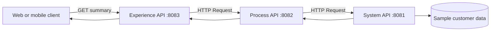

# 17.1 — API-Led Connectivity Architecture and Lab Design

## 1. The three layers

API-led connectivity organizes integration capabilities into APIs with clear responsibilities. It is an architectural approach, not a rule that every organization must deploy exactly three applications for every use case.

### System API — unlock the source

A System API provides a stable interface to a system of record or technical capability. It hides source-specific details and exposes only the operations consumers need.

In this lab: `GET /api/customers/{customerId}` returns a sample customer record.

It should **not** tailor the payload for a particular web page, and it should not become a dumping ground for every business workflow.

### Process API — coordinate business data

A Process API composes system capabilities, applies reusable business rules, and creates a business-level result. It should be reusable by more than one channel when the business capability is shared.

In this lab: call the System API, calculate an order summary, and return a normalized customer-and-orders structure. For the self-contained demo, order data is sample data held in the Process API.

### Experience API — serve the consumer

An Experience API shapes the result for a particular consumer such as a mobile app, partner portal, or web channel. It can rename fields, reduce payload size, or combine data already exposed by process-level capabilities, but it should not directly reach around the Process API to call the backend in this lab.

In this lab: expose `GET /api/customers/{customerId}/summary`.

## 2. Request path



The response travels back through the same chain. Each arrow between Mule apps is a real HTTP request in this local exercise.

## 3. Sample data contract

System API returns:

```json
{
  "customerId": "C-100",
  "firstName": "Asha",
  "lastName": "Sharma",
  "email": "asha@example.com",
  "status": "ACTIVE"
}
```

The Process API enriches it with a sample order summary:

```json
{
  "customer": {
    "customerId": "C-100",
    "firstName": "Asha",
    "lastName": "Sharma",
    "email": "asha@example.com",
    "status": "ACTIVE"
  },
  "orders": {
    "count": 2,
    "totalValue": 1499.5,
    "currency": "INR"
  }
}
```

The Experience API presents a channel-friendly response:

```json
{
  "id": "C-100",
  "name": "Asha Sharma",
  "email": "asha@example.com",
  "membershipStatus": "ACTIVE",
  "orderSummary": {
    "orderCount": 2,
    "totalValue": 1499.5,
    "currency": "INR"
  }
}
```

These values are fictional learning data.

## 4. Application and port plan

Create three Mule projects per POC:

| App | Port | Inbound route | Outbound dependency |
|---|---:|---|---|
| `customer-system-api` | 8081 | `/api/customers/{customerId}` | Sample data only |
| `customer-process-api` | 8082 | `/api/customer-summary/{customerId}` | System API at 8081 |
| `customer-experience-api` | 8083 | `/api/customers/{customerId}/summary` | Process API at 8082 |

The names are project names, not mandatory naming standards. If you use APIkit, the generated flow names may differ; route the generated resource to the same business behavior.

## 5. Responsibility boundaries

| Question | Correct owner in this lab |
|---|---|
| How is a source customer record fetched? | System API |
| How are customer data and order totals combined? | Process API |
| What response shape does the mobile client receive? | Experience API |
| Where should source-specific fields be normalized? | Usually System API, depending on reuse |
| Where should a channel-only field rename occur? | Experience API |
| Does importing RAML implement database or business logic? | No |

## 6. Prerequisites

- Anypoint Studio with a Mule 4 runtime supported by your Studio version.
- Basic familiarity with HTTP Listener, HTTP Request, Transform Message, and DataWeave.
- Postman or curl.
- Three available local ports: 8081, 8082, and 8083.

Connector and APIkit wizard labels can differ by Studio version. Use the matching current menu item in your installation.

## 7. Build strategy

Build and test **System → Process → Experience** in that order. This ensures every downstream call has a known working target. Start the lower-level apps before the Experience API.

For the two POCs, keep the URLs and sample data the same. Only the method used to define and route the Experience API changes: API contract plus APIkit in POC 1, versus a manually configured HTTP Listener and route in POC 2.
