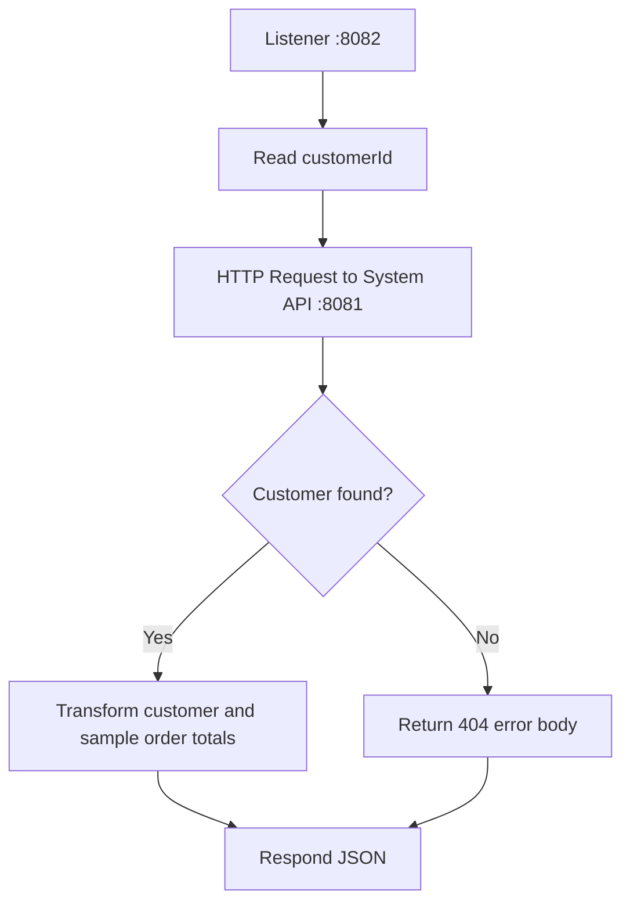

# 17.4 — POC 1: Implement System, Process, and Experience Layers

This lesson completes the first POC. Only the Experience API is contract-first in the exercise; System and Process are separate Mule applications built with ordinary HTTP Listener and HTTP Request components. This keeps the focus on how the layers communicate rather than creating three unrelated scaffolds.

## 1. Build the System API

Create a Mule project named `customer-system-api`.

### Inbound route

- HTTP Listener: host `0.0.0.0` or `localhost` for a local-only lab, port `8081`.
- Path: `/api/customers/{customerId}`.
- Return JSON.

### Sample implementation

For a simple demo, use a Transform Message after the Listener. The following is a conceptual DataWeave mapping; adapt the URI parameter expression to the actual attributes visible in your Studio flow.

```dataweave
%dw 2.0
output application/json
var id = attributes.uriParams.customerId default ""
---
if (id == "C-100")
  {
    customerId: "C-100",
    firstName: "Asha",
    lastName: "Sharma",
    email: "asha@example.com",
    status: "ACTIVE"
  }
else if (id == "C-200")
  {
    customerId: "C-200",
    firstName: "Rohan",
    lastName: "Mehta",
    email: "rohan@example.com",
    status: "INACTIVE"
  }
else
  {
    code: "CUSTOMER_NOT_FOUND",
    message: "No customer exists for the supplied ID."
  }
```

**Important:** This simple mapping illustrates the lookup logic, but returning an error object alone does not set HTTP 404. Implement a deliberate branch/error strategy that sets HTTP status 404 for unknown IDs. One beginner-friendly option is to use a Choice router before the success response, or a variable/flow-level error strategy based on whether the ID exists. Verify the response status in Postman.

A clean implementation can set `vars.customerFound` based on the ID, route with Choice, return the customer payload on success, and set the Listener response status to 404 in the not-found path.

### Test System API first

- `GET http://localhost:8081/api/customers/C-100` → customer JSON.
- `GET http://localhost:8081/api/customers/C-200` → second customer JSON.
- `GET http://localhost:8081/api/customers/C-999` → HTTP 404 and `ApiError` JSON.

Do not proceed until these outcomes are correct.

## 2. Build the Process API

Create `customer-process-api`.

- HTTP Listener: port `8082`.
- Path: `/api/customer-summary/{customerId}`.
- HTTP Request: call System API at port `8081`, path `/api/customers/{customerId}`.
- For the learning POC, order totals are sample values held in the Process API.

A clear flow outline:



Use an HTTP Request configuration with host `localhost`, port `8081`, and the System API path. Build the path using the URI parameter from the Process API's incoming request. Exact expression placement depends on the HTTP Request configuration UI; use a path expression or URI-parameter configuration supported by your connector version.

### Process API output

For `C-100`, produce the following normalized structure:

```json
{
  "customer": {
    "customerId": "C-100",
    "firstName": "Asha",
    "lastName": "Sharma",
    "email": "asha@example.com",
    "status": "ACTIVE"
  },
  "orders": {
    "count": 2,
    "totalValue": 1499.5,
    "currency": "INR"
  }
}
```

A sample enrichment transform:

```dataweave
%dw 2.0
output application/json
---
{
  customer: payload,
  orders: {
    count: 2,
    totalValue: 1499.5,
    currency: "INR"
  }
}
```

This assumes the HTTP Request response payload is the System API's customer JSON. Real integrations should obtain order data from an actual order capability or a separate System API rather than hardcoding it.

## 3. Connect the Experience API

In the APIkit-generated GET resource flow from 17.3:

1. Read the incoming customer ID.
2. Call `GET http://localhost:8082/api/customer-summary/{customerId}`.
3. Transform the Process API result to the Experience contract using the DataWeave mapping in 17.3.
4. Return `application/json`.
5. Deliberately handle downstream 404, timeout, and connection errors.

The intended request chain is **client → Experience → Process → System**. The Experience API should not bypass the Process API and call the System API directly.

## 4. Start-up order

1. Start System API on 8081.
2. Test System API directly.
3. Start Process API on 8082.
4. Test Process API directly.
5. Import/build and start Experience API on 8083.
6. Test the end-to-end route.

## 5. End-to-end test

Request:

```bash
curl -i http://localhost:8083/api/customers/C-100/summary
```

Expected body:

```json
{
  "id": "C-100",
  "name": "Asha Sharma",
  "email": "asha@example.com",
  "membershipStatus": "ACTIVE",
  "orderSummary": {
    "orderCount": 2,
    "totalValue": 1499.5,
    "currency": "INR"
  }
}
```

Expected status: `200 OK`.

Unknown ID:

```bash
curl -i http://localhost:8083/api/customers/C-999/summary
```

Expected status: `404 Not Found` with a documented error body. Confirm that the actual status survives each layer; a JSON error body by itself is not proof of a correct HTTP error.

## 6. POC 1 checklist

- [ ] RAML is the source contract for the Experience API.
- [ ] APIkit Router dispatches the GET operation.
- [ ] Experience API calls Process API.
- [ ] Process API calls System API.
- [ ] System API owns source lookup.
- [ ] Process API owns enrichment/orchestration.
- [ ] Experience API owns consumer response shape.
- [ ] Success and not-found statuses are correct.

Next: [17.5 — POC 2: Build All Three Layers Without RAML](17.5-POC-2-API-Led-Without-RAML.md)
