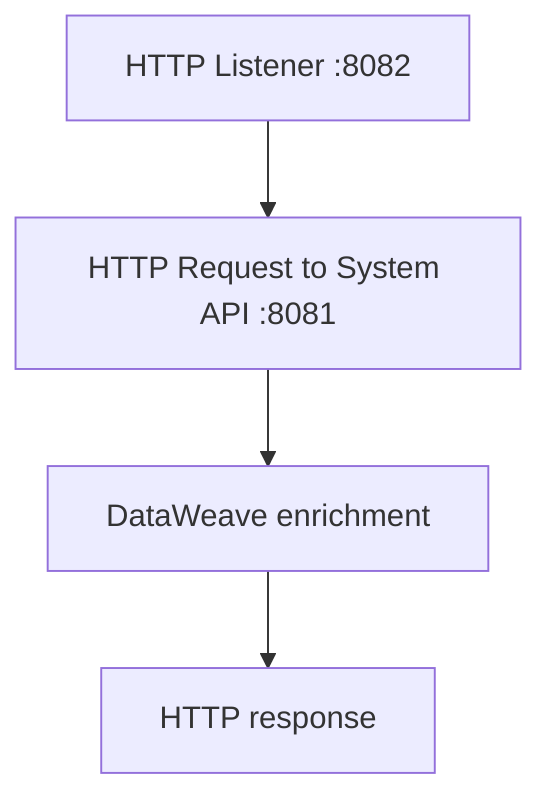

# 17.5 — POC 2: Build All Three Layers Without RAML

Now rebuild the same Customer 360 behavior without importing a RAML specification and without APIkit scaffolding. You will configure HTTP Listener routes manually and implement the response shape yourself.

> “Without RAML” means the implementation is not generated from a RAML contract. You still need to document the endpoints, payloads, and errors; absence of a contract file does not remove the need for an API design.

## 1. Create three Mule applications

Create:

- `customer-system-api-manual` — port 8081.
- `customer-process-api-manual` — port 8082.
- `customer-experience-api-manual` — port 8083.

If POC 1 is still running, stop it or use different ports. Two apps cannot bind to the same host/port at once.

## 2. System API: manual Listener and lookup

Add an HTTP Listener with:

- Host: `0.0.0.0` for a local lab reachable from your machine; use `localhost` if you need it to be local-only.
- Port: `8081`.
- Path: `/api/customers/{customerId}` (configure URI-template support as available in your connector version).

Use a Choice router to check the customer ID. Return the sample customer JSON for C-100 and C-200. For any other ID, return an error body and explicitly set the response status to 404.

Keep the sample records and response shape identical to POC 1.

## 3. Process API: manual orchestration

Create a Listener on port 8082 at `/api/customer-summary/{customerId}`.

Flow outline:



Configure HTTP Request to call the System API route using the incoming ID. Then transform the successful response to the same process structure:

```dataweave
%dw 2.0
output application/json
---
{
  customer: payload,
  orders: {
    count: 2,
    totalValue: 1499.5,
    currency: "INR"
  }
}
```

Add an explicit error path for a System API 404 and a separate strategy for connection failures/timeouts. Do not turn every failure into “customer not found”: an unavailable System API is an upstream dependency failure, not evidence that the customer does not exist.

## 4. Experience API: manual route

Create a Listener on port 8083 at `/api/customers/{customerId}/summary`.

Add HTTP Request to call the Process API on port 8082, then use Transform Message to produce the response:

```dataweave
%dw 2.0
output application/json
---
{
  id: payload.customer.customerId,
  name: payload.customer.firstName ++ " " ++ payload.customer.lastName,
  email: payload.customer.email,
  membershipStatus: payload.customer.status,
  orderSummary: {
    orderCount: payload.orders.count,
    totalValue: payload.orders.totalValue,
    currency: payload.orders.currency
  }
}
```

Configure the Listener response with the right status code and JSON content type. Since there is no RAML/APIkit router, you are responsible for matching the path/method and keeping implementation behavior consistent with your documentation.

## 5. Test the same requests

Success:

```bash
curl -i http://localhost:8083/api/customers/C-100/summary
```

Not found:

```bash
curl -i http://localhost:8083/api/customers/C-999/summary
```

Test each layer independently, too:

```bash
curl -i http://localhost:8081/api/customers/C-100
curl -i http://localhost:8082/api/customer-summary/C-100
```

Use Postman if you prefer a GUI. Compare status codes, content types, and JSON structure—not only whether the request returns some body.

## 6. What you must document manually

Create a short API note in your project README or a Markdown file recording:

- Base URL and port.
- Method and path.
- Path/query parameters.
- Required headers and media types.
- Success response example.
- Error response examples and HTTP status.
- Timeout and dependency-failure behavior.
- Versioning and change policy.

Without RAML, APIkit does not scaffold the resource flows from a RAML contract. You create and maintain routing, implementation, and documentation yourself.

## 7. Checklist

- [ ] Three distinct Mule applications run on the planned ports.
- [ ] All three layers have clear, separate responsibilities.
- [ ] The Experience API calls only the Process API.
- [ ] The Process API calls the System API.
- [ ] The System API owns the customer lookup.
- [ ] The manually implemented response matches the same contract as POC 1.
- [ ] Unknown ID and upstream outage are treated differently.
- [ ] You have written down the API contract manually.

Next: [17.6 — Test Both POCs, Troubleshoot, and Compare](17.6-Test-Troubleshoot-and-Compare-Both-POCs.md)
