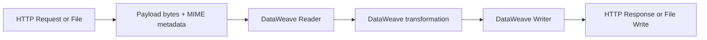
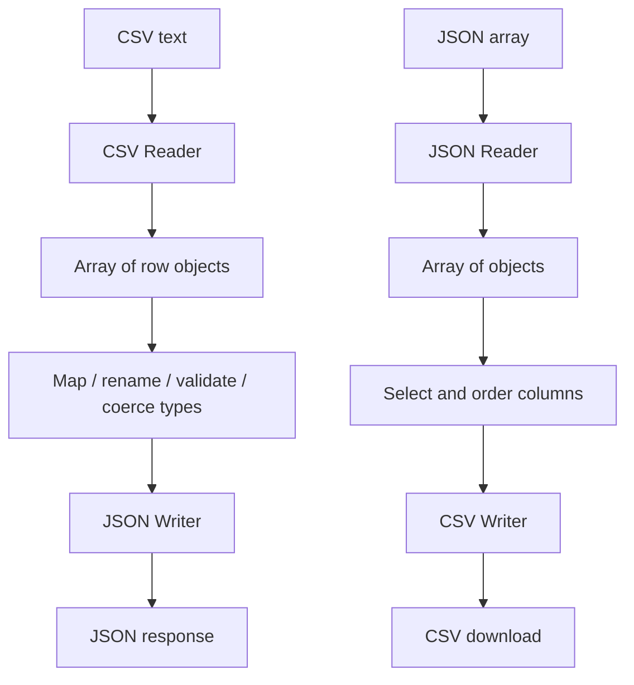
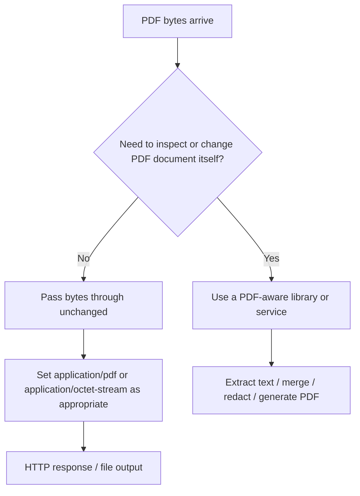

# Chapter 18 — Data Transformation in Mule 4: CSV, JSON, PDF, Binary, and Octet Streams

> **Learning goal:** Learn to identify incoming data formats, configure readers, transform structured data with DataWeave, and return or save the correct representation from a Mule flow. This chapter includes Mule 4 flows, copyable configurations, sequence diagrams, Studio canvas snapshots rendered as diagrams, and practice tasks.

## Start here

1. [18.1 — Data Formats, MIME Types, and the Transformation Pipeline](18.1-Data-Formats-MIME-Types-and-Transformation-Pipeline.md)
2. [18.2 — CSV to JSON: End-to-End HTTP API](18.2-CSV-to-JSON-End-to-End-HTTP-API.md)
3. [18.3 — JSON to CSV: End-to-End Download API](18.3-JSON-to-CSV-End-to-End-Download-API.md)
4. [18.4 — File Connector: Read CSV, Transform, and Write JSON](18.4-File-Connector-CSV-to-JSON.md)
5. [18.5 — Binary, Octet-Stream, and PDF Handling](18.5-Binary-Octet-Stream-and-PDF-Handling.md)
6. [18.6 — Base64, Attachments, HTTP Headers, and Safe Binary Delivery](18.6-Base64-Attachments-and-HTTP-Responses.md)
7. [18.7 — Testing, Troubleshooting, and Studio Flow Snapshots](18.7-Testing-Troubleshooting-and-Flow-Snapshots.md)
8. [18.8 — Practice Questions, Mini Labs, and Capstone](18.8-Practice-Questions-Mini-Labs-and-Capstone.md)

## What you will build

| Lab | Input | Processing | Output |
|---|---|---|---|
| A | CSV request body | DataWeave CSV reader → JSON writer | `application/json` |
| B | JSON request body | DataWeave JSON reader → CSV writer | `text/csv` download |
| C | CSV file from disk | File Read → DataWeave → File Write | JSON file |
| D | PDF file or binary HTTP body | Pass through bytes, set metadata | Original binary bytes / PDF download |
| E | Base64 JSON field | Decode Base64 | Binary payload with intended MIME type |

## Architecture diagrams

### Structured-text transformation

### CSV ↔ JSON

### Binary pass-through vs data transformation

## Important distinctions

- **Data format is not the same as MIME type.** DataWeave readers and writers use format information to parse or serialize data; HTTP headers describe the response sent to a client.
- **CSV to JSON** and **JSON to CSV** are structured-data transformations. DataWeave's CSV reader typically presents rows as objects, with simple field values represented as strings. Convert values to numbers, booleans, or dates explicitly when required.
- **PDF is not an ordinary DataWeave text format.** A PDF normally arrives as binary content. Passing it through preserves bytes; it does not extract PDF text or create a PDF document.
- **`application/octet-stream` means generic binary content.** For a known PDF file, `application/pdf` is usually more descriptive. Do not parse a binary payload as JSON or CSV.
- **Base64 is an encoding, not a file format conversion.** Decoding Base64 bytes does not by itself convert, validate, or interpret a PDF.
- **Studio snapshots:** GitHub Markdown cannot capture a local Anypoint Studio canvas automatically. This chapter includes reproducible Studio canvas diagrams and Mule XML snippets as implementation snapshots. They are schematic, not screenshots of a running Studio instance. Add actual Studio screenshots after importing and running the app locally.

## Prerequisites

- Mule 4 project in Anypoint Studio.
- HTTP Connector and File Connector available in the project.
- Familiarity with DataWeave `map`, selectors, types, and `default`.
- Postman or curl for request/response testing.

## Official documentation

- [DataWeave supported data formats](https://docs.mulesoft.com/dataweave/2.6/dataweave-formats)
- [CSV format](https://github.com/mulesoft/docs-dataweave/blob/v2.12/modules/ROOT/pages/dataweave-formats-csv.adoc)
- [Binary format](https://docs.kqa.platform.mulesoft.com/dataweave/latest/dataweave-formats-binary)
- [DataWeave write function](https://github.com/mulesoft/docs-dataweave/blob/v2.12/modules/ROOT/pages/dw-core-functions-write.adoc)
- [File Connector](https://docs.mulesoft.com/file-connector/latest/)
- [HTTP Listener reference](https://docs.mulesoft.com/http-connector/latest/http-listener-ref)
- [MuleSoft DataWeave introduction](https://developer.mulesoft.com/tutorials-and-howtos/dataweave/what-is-dataweave-getting-started-tutorial/)

> Verify XML namespaces, connector versions, listener response settings, and DataWeave scripts in your target Mule runtime. The snippets are teaching templates and are not claimed to have been executed in Anypoint Studio in this repository.
