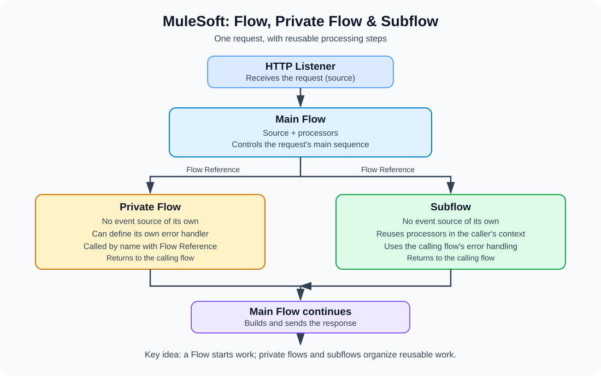

# Chapter 3 — Mule Flows

## 3.1 Flow, Private Flow, and Subflow

In Mule 4, a **flow** is a sequence of processors that handles a Mule event. Use flows to receive requests, transform data, call systems, and return responses.

### 1. Flow

A regular **flow** usually has an event source—such as an **HTTP Listener** or a Scheduler—that starts processing. Its processors then run in order.

**Example:** An HTTP Listener receives `GET /customers`, a flow calls a customer service, and the flow returns the result.

### 2. Private Flow

A **private flow** is a flow with **no event source of its own**. It is invoked from another flow in the same Mule application using a **Flow Reference** (`flow-ref`). It is useful for a reusable sequence of steps and can have its own error handler.

**Example:** The main flow calls a private flow named `get-customer-details` to retrieve customer information.

### 3. Subflow

A **subflow** also has **no event source of its own** and is called using a **Flow Reference**. It is useful for a small reusable sequence of processors. A subflow runs in the calling flow's processing context and uses the calling flow's error-handling strategy; configure error handling in the calling flow.

**Example:** Several flows reuse a subflow that normalizes customer data.

## Diagram: How They Work Together

The diagram shows a request entering the main flow. The main flow can call a private flow or a subflow using Flow Reference; after the referenced processing finishes, execution returns to the caller.

## Quick Comparison

| Feature | Flow | Private Flow | Subflow |
|---|---|---|---|
| Has its own event source | Usually yes | No | No |
| Can be called with Flow Reference | Yes, where applicable | Yes | Yes |
| Own error handler | Yes | Yes | No; uses caller's handling |
| Best for | Starting and coordinating processing | Reusable processing with its own error handling | Lightweight reusable processor sequence |

**Remember:** A regular flow commonly starts work. A private flow and a subflow are reusable sequences called by another flow. The main practical difference between a private flow and a subflow is their processing and error-handling behavior.

