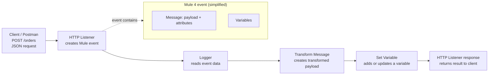

# 8.1 — Event, Mule Event, and Mule 3 vs Mule 4 Events

A **Mule event** is the information Mule runtime processes as it moves through a flow. When an HTTP Listener receives a request, Mule creates an event from that request. Processors such as Logger, Transform Message, Set Variable, and HTTP Request then work with that event.

This lesson explains what an event is, the main parts of a Mule 4 event, how Mule 3 differed, and a small example you can test.

## 1. What is an event?

In everyday language, an *event* is something that happens. In an integration application, an event is a unit of information that triggers or travels through processing.

For example, when Postman sends this request:

- Method: `POST`
- URL: `http://localhost:8081/orders`
- Body: `{"orderId":101,"customer":"Asha","amount":250}`

the HTTP Listener receives the request and starts the Mule flow. Mule represents the request data and its metadata in a Mule event.

## 2. Diagram: a Mule event moving through a flow

The diagram below shows a simplified Mule 4 request lifecycle. Each processor can read the event and may produce an updated event for the next processor.



**Remember:** the event is the context moving through the flow. The **message** is one part of the event; it is not the entire event.

## 3. Main parts of a Mule 4 event

A Mule 4 event is commonly understood as having two main parts:

### A. Message

The message contains:

- **Payload** — the main data being processed, such as a JSON order.
- **Attributes** — metadata about the current message, supplied by the source or connector. For an HTTP Listener, this can include the HTTP method, headers, query parameters, and URI parameters.

Example expressions:

| Expression | Meaning |
|---|---|
| `#[payload]` | The current message payload |
| `#[attributes.method]` | HTTP method, when the source is an HTTP Listener |
| `#[attributes.queryParams]` | HTTP query parameters |
| `#[attributes.uriParams.orderId]` | A URI parameter named `orderId`, if the listener path defines it |

Attributes depend on the source and connector. A file source, for example, provides different attributes from an HTTP Listener.

### B. Variables

**Variables** store additional values for use later in the same event's processing. You can create or update one with **Set Variable**.

For example:

- Payload: the incoming order JSON.
- Attributes: HTTP request metadata.
- Variable `sourceSystem`: `"postman-demo"`.

Read the variable with `#[vars.sourceSystem]`.

A processor may replace the payload, update variables, or produce a new message while the flow continues. Do not assume every processor changes the payload.

## 4. Mule 3 event vs Mule 4 event

The main conceptual change is that Mule 4 simplified the message/event model and removed the old inbound/outbound property model.

| Concept | Mule 3 | Mule 4 |
|---|---|---|
| Main structure | A Mule event carries a `MuleMessage` | A Mule event carries a Mule message and variables |
| Message data | `MuleMessage` has payload and properties/attachments | Message has payload and attributes |
| Inbound metadata | Inbound properties were associated with the message | Source metadata is represented as message attributes |
| Outbound metadata | Outbound properties could be set for outgoing messages | Connector/operation configuration and message attributes are used as appropriate; no general outbound-properties bucket |
| Flow-level values | Invocation/session properties were used for values beyond the payload | Use event variables, accessed as `vars` |
| Typical payload expression | `#[payload]` | `#[payload]` |
| Typical variable expression | Depends on property type; e.g. invocation property expressions | `#[vars.variableName]` |
| Practical mindset | Understand message plus inbound/outbound and invocation/session properties | Understand event as message (payload + attributes) plus variables |

**Important:** Mule 3 and Mule 4 are different runtime generations. Do not copy Mule 3 property expressions or XML into a Mule 4 application. In Mule 4, use `attributes` for source metadata and `vars` for variables.

## 5. Example: inspect and transform an incoming order

We'll build a small Mule 4 flow that receives an order, logs its ID, stores the source name in a variable, and returns a compact response.

### Expected request

Send this in Postman:

- Method: `POST`
- URL: `http://localhost:8081/orders`
- Header: `Content-Type: application/json`
- Body → raw → JSON:

```json
{
  "orderId": 101,
  "customer": "Asha",
  "amount": 250
}
```

### Build it in Anypoint Studio

1. Create a Mule project and add an **HTTP Listener** as the source.
2. Create or select a global HTTP Listener configuration with host `localhost` and port `8081`.
3. Set the Listener path to `/orders`.
4. Add a **Logger** after the Listener. Set its message to `#[payload.orderId]` or `Order received: #[payload.orderId]`.
5. Add **Set Variable**. Set Variable Name to `sourceSystem` and Value to `"postman-demo"` (as a DataWeave expression/string value in Studio).
6. Add **Transform Message** after Set Variable and configure the output as JSON.
7. Use the DataWeave script below.
8. Run the project, then send the request from Postman.

### DataWeave transformation

```dataweave
%dw 2.0
output application/json
---
{
  message: "Order received",
  orderId: payload.orderId,
  customer: payload.customer,
  amount: payload.amount,
  source: vars.sourceSystem
}
```

### Expected response

```json
{
  "message": "Order received",
  "orderId": 101,
  "customer": "Asha",
  "amount": 250,
  "source": "postman-demo"
}
```

Your exact formatting and field order may differ, but the values should match. In the Logger output, you should see the order ID. In the transformed response, `vars.sourceSystem` demonstrates how a variable is part of the event context but is not itself the payload.

## 6. Follow the event through the example

| Point in the flow | Payload | Attributes | Variables |
|---|---|---|---|
| After HTTP Listener | Incoming order JSON | HTTP request metadata, such as method and headers | No `sourceSystem` variable yet |
| After Logger | Same order JSON | Same source metadata | Unchanged |
| After Set Variable | Same order JSON | Same source metadata | `sourceSystem = "postman-demo"` |
| After Transform Message | Transformed response JSON | Usually still available on the event; exact behavior depends on the processor and flow | `sourceSystem` remains available |

This table is a simplified learning model, not a promise that every connector or processor behaves identically. A connector operation may create its own message and attributes.

## 7. Common beginner mistakes

- **Calling the payload the whole event:** the payload is only the main data inside the message.
- **Confusing attributes with variables:** attributes describe metadata provided by the source/operation; variables are values your flow stores.
- **Using Mule 3 property terminology in Mule 4:** use `attributes` and `vars` in Mule 4 expressions.
- **Assuming attributes are always HTTP attributes:** attributes depend on which source or connector produced the current message.
- **Assuming payload never changes:** Transform Message and Set Payload can change it.

## Practice checklist

- [ ] Explain the difference between a Mule event and its message.
- [ ] Identify payload, attributes, and variables in the example.
- [ ] Change the request's `orderId` and verify the Logger output and response.
- [ ] Change `sourceSystem` to `"web-store"` and verify the response.
- [ ] Explain one difference between Mule 3 properties and Mule 4 attributes/variables.

## Independent practice challenge

Build a `POST /customers` flow that accepts JSON containing `customerId` and `name`. Log the customer ID, store `"customer-api"` in a variable named `sourceSystem`, and return a JSON response containing the customer ID, name, and source system.

Do not copy the order example unchanged: configure the endpoint, request body, variable, log message, and transformation for customers yourself.

## Further reading

- [Mule Runtime Engine — Mule event](https://docs.mulesoft.com/mule-runtime/latest/about-mule-event)
- [Mule 4 migration concepts](https://docs.mulesoft.com/mule-runtime/latest/migration-core-concepts)
- [Set Variable component](https://docs.mulesoft.com/mule-runtime/latest/set-variable-component-reference)
