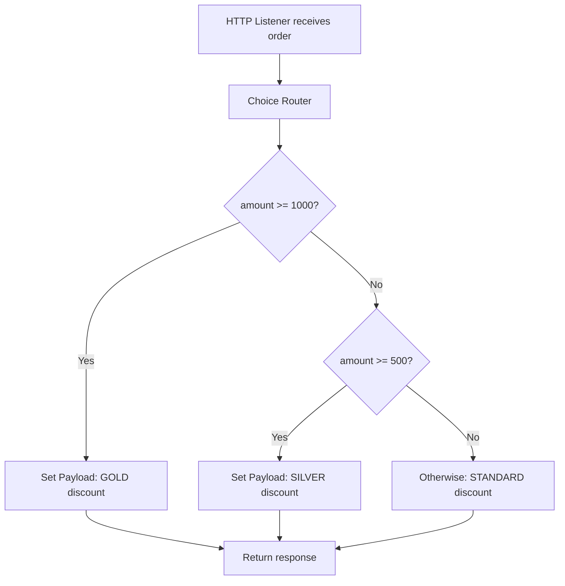

# 9.1 — Choice Router with Implementation

The **Choice Router** routes a Mule event through one of several processing paths based on conditions. It is similar to an `if / else if / else` decision in programming.

Use it when the next step depends on the incoming payload, a variable, or attributes—for example, choosing a discount based on an order amount.

## What you will build

Create a `POST /orders/discount` endpoint that accepts an order amount and returns the discount category:

- Amount greater than or equal to 1,000 → `"GOLD"`
- Amount greater than or equal to 500 but below 1,000 → `"SILVER"`
- Anything else → `"STANDARD"`

## 1. How the Choice Router works

The router evaluates its `when` conditions in order. The first matching route runs. If no condition matches, the `otherwise` route runs when one is configured.



**Important:** Conditions are evaluated in the order configured. Put the more specific or higher threshold first, otherwise a broad condition may catch a request before a later condition can be reached.

## 2. Build it in Anypoint Studio

1. Create a Mule project, for example `choice-router-demo`.
2. Drag an **HTTP Listener** onto the canvas.
3. Create a global Listener configuration with host `localhost` and port `8081`.
4. Set the Listener path to `/orders/discount`.
5. Add a **Choice** router after the Listener.
6. Add two **When** routes and keep the **Otherwise** route for the default case.
7. In the first When condition, use `#[payload.amount >= 1000]`. Add a **Set Payload** inside it with the GOLD response shown below.
8. In the second When condition, use `#[payload.amount >= 500]`. Add a **Set Payload** inside it with the SILVER response.
9. Inside Otherwise, add a **Set Payload** with the STANDARD response.
10. Run the project and test the cases in Postman.

Send JSON using **POST**, URL `http://localhost:8081/orders/discount`, and header `Content-Type: application/json`.

Example request body:

```json
{
  "orderId": 101,
  "amount": 750
}
```

## 3. Configure the routes

In the Choice Router's **When** expression field, enter the expression without wrapping it in quotation marks:

First When:

```dataweave
#[payload.amount >= 1000]
```

Set Payload for this route:

```dataweave
%dw 2.0
output application/json
---
{
  orderId: payload.orderId,
  amount: payload.amount,
  discountCategory: "GOLD",
  message: "Eligible for gold discount"
}
```

Second When:

```dataweave
#[payload.amount >= 500]
```

Set Payload for this route:

```dataweave
%dw 2.0
output application/json
---
{
  orderId: payload.orderId,
  amount: payload.amount,
  discountCategory: "SILVER",
  message: "Eligible for silver discount"
}
```

Otherwise Set Payload:

```dataweave
%dw 2.0
output application/json
---
{
  orderId: payload.orderId default null,
  amount: payload.amount default 0,
  discountCategory: "STANDARD",
  message: "Standard discount category"
}
```

These scripts assume the request body is valid JSON and `amount` is numeric. Production APIs should validate missing or incorrectly typed values before the Choice Router.

## 4. Test in Postman

| Request amount | Expected category | Why |
|---:|---|---|
| `1200` | `GOLD` | Meets the first condition |
| `750` | `SILVER` | Fails first, meets second |
| `250` | `STANDARD` | Neither When condition matches |

Example response for amount `750`:

```json
{
  "orderId": 101,
  "amount": 750,
  "discountCategory": "SILVER",
  "message": "Eligible for silver discount"
}
```

The exact JSON formatting may vary, but the fields and values should match.

## 5. XML shape (conceptual)

Studio generates XML based on your configuration. A simplified shape is:

```xml
<flow name="orderDiscountFlow">
    <http:listener config-ref="HTTP_Listener_config" path="/orders/discount"/>
    <choice>
        <when expression="#[payload.amount >= 1000]">
            <set-payload value='#[{orderId: payload.orderId, amount: payload.amount, discountCategory: "GOLD"}]'/>
        </when>
        <when expression="#[payload.amount >= 500]">
            <set-payload value='#[{orderId: payload.orderId, amount: payload.amount, discountCategory: "SILVER"}]'/>
        </when>
        <otherwise>
            <set-payload value='#[{orderId: payload.orderId default null, amount: payload.amount default 0, discountCategory: "STANDARD"}]'/>
        </otherwise>
    </choice>
</flow>
```

Treat this as an illustration of the structure, not a drop-in complete application file. Exact XML and expression syntax can vary with Studio/connector versions; configuring the components visually in Studio is recommended for beginners.

## Common mistakes

- Writing `payload.amount >= 500` without the Mule expression wrapper in a field that expects a Mule expression.
- Placing the lower threshold before the higher threshold.
- Forgetting the Otherwise route and not knowing what happens when no condition matches.
- Comparing a string amount with a number. Send `amount` as a JSON number, not `"750"`.
- Assuming Choice itself creates a response; each route needs processing that sets the desired result.

## Practice checklist

- [ ] Test amounts 1200, 750, and 250.
- [ ] Swap the two conditions temporarily and observe why ordering matters.
- [ ] Add a new condition for amounts greater than or equal to 2,000 with category `"PLATINUM"`.
- [ ] Explain what happens when no When condition matches.

## Independent practice challenge

Build `POST /shipping/quote`. Based on numeric `orderTotal`, return `"FREE"` when the total is at least 100, `"EXPRESS"` when the total is at least 50, and `"STANDARD"` otherwise. Include the original order total in the JSON response and test all three routes.

## Official references

- [Choice Router](https://docs.mulesoft.com/mule-runtime/latest/choice-router-concept)
- [Set Payload component](https://docs.mulesoft.com/mule-runtime/latest/set-payload-transformer-reference)
- [HTTP Connector](https://docs.mulesoft.com/http-connector/latest/)
