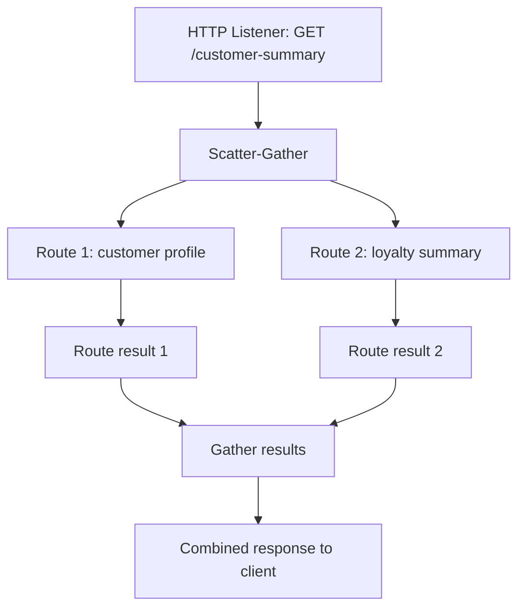

# 9.2 — Scatter-Gather with Implementation

**Scatter-Gather** sends the same incoming Mule event to multiple routes for processing and then gathers the results into one combined payload. The routes execute in parallel, so this pattern is useful when independent tasks can run at the same time.

In this tutorial, build a simple customer summary endpoint. It will run two independent routes: one prepares a customer profile summary, and the other prepares a loyalty summary. Scatter-Gather gathers both route results into one response.

## 1. How Scatter-Gather works



Each route processes its own copy of the incoming event. Scatter-Gather waits for the routes to finish and gathers their results. In Mule 4, the gathered payload is typically an array of route results, with one result per route in route order. The exact shape depends on what each route returns and on error handling.

## 2. What you will build

Endpoint: `GET http://localhost:8081/customer-summary?customerId=42`

The routes will return:

- Route 1 — profile: customer ID and display name.
- Route 2 — loyalty: customer ID and points.

The final response will contain both results. This example uses Set Payload in each route to make the behavior easy to see. In a real integration, the routes might call separate services using HTTP Request or different connectors.

## 3. Build it in Anypoint Studio

1. Create a Mule project named `scatter-gather-demo`.
2. Add an **HTTP Listener** with host `localhost`, port `8081`, and path `/customer-summary`.
3. Add a **Scatter-Gather** component after the Listener.
4. In the Scatter-Gather component, configure two routes.
5. In Route 1, add **Set Payload** and set it to a JSON object representing the profile.
6. In Route 2, add **Set Payload** and set it to a JSON object representing the loyalty details.
7. Ensure each Set Payload is configured to output JSON (or use the DataWeave scripts below).
8. Run the app and call the endpoint in Postman.

No request body is needed for this GET example. The customer ID comes from the query parameter `customerId`.

## 4. Configure the two routes

### Route 1 — Customer profile

Add a Set Payload component inside the first Scatter-Gather route:

```dataweave
%dw 2.0
output application/json
var customerId = attributes.queryParams.customerId default "unknown"
---
{
  section: "profile",
  customerId: customerId,
  displayName: "Asha Sharma"
}
```

### Route 2 — Loyalty summary

Add a Set Payload component inside the second route:

```dataweave
%dw 2.0
output application/json
var customerId = attributes.queryParams.customerId default "unknown"
---
{
  section: "loyalty",
  customerId: customerId,
  points: 180
}
```

Both routes read the original incoming event's query parameter. They each set their own route payload; one route's Set Payload does not overwrite the other route's result.

## 5. Test in Postman

Send:

```http
GET http://localhost:8081/customer-summary?customerId=42
```

You should receive a gathered result containing both route results, conceptually like this:

```json
[
  {
    "section": "profile",
    "customerId": "42",
    "displayName": "Asha Sharma"
  },
  {
    "section": "loyalty",
    "customerId": "42",
    "points": 180
  }
]
```

This illustrates the gathered payload shape. Depending on the Studio/runtime version and the way output metadata is configured, the display may differ. Verify the actual payload in the debugger or Postman.

## 6. When is Scatter-Gather useful?

Use it when independent operations can run concurrently, such as:

- Retrieve profile information from one system and loyalty points from another.
- Query inventory and pricing services separately.
- Fetch several independent pieces of data needed for a composite API response.

Avoid using it when the second operation depends on the first operation's result. For dependent steps, use a normal sequence or another suitable routing pattern.

## 7. Error handling and practical considerations

- Scatter-Gather waits for all routes to complete before producing the gathered result.
- If a route fails, Scatter-Gather can raise a `MULE:COMPOSITE_ROUTING` error containing route failures. Plan error handling for the whole component and, where appropriate, within individual routes.
- A failure in one route should not be silently treated as a successful response unless that behavior is an explicit API requirement.
- Routes run concurrently. Do not rely on one route to update a variable that another route then reads; the routes are designed for independent work.
- For real services, configure sensible connection/read timeouts and avoid logging secrets or personal data.
- Use Scatter-Gather for independent work, not merely to split a flow into multiple branches.

## 8. XML shape (conceptual)

A simplified Studio-generated structure looks like this:

```xml
<flow name="customerSummaryFlow">
    <http:listener config-ref="HTTP_Listener_config" path="/customer-summary"/>
    <scatter-gather>
        <route>
            <!-- Set Payload: profile result -->
        </route>
        <route>
            <!-- Set Payload: loyalty result -->
        </route>
    </scatter-gather>
</flow>
```

This shows the structure only; configure the route processors in Studio to generate valid XML for your version.

## Practice checklist

- [ ] Confirm both routes execute and their results are gathered.
- [ ] Change the query parameter and verify both route results use the new customer ID.
- [ ] Inspect the gathered payload in the debugger.
- [ ] Explain why the routes should be independent.
- [ ] Consider what response your API should return if one route fails.

## Independent practice challenge

Create `GET /product-overview?sku=ABC-100` with two Scatter-Gather routes: one returns product details (SKU and name), and the other returns inventory details (SKU and available quantity). Gather both results and test with a different SKU. Do not use the customer example's names or values unchanged.

## Official references

- [Scatter-Gather Router](https://docs.mulesoft.com/mule-runtime/latest/scatter-gather-concept)
- [HTTP Connector](https://docs.mulesoft.com/http-connector/latest/)
- [Mule error handling](https://docs.mulesoft.com/mule-runtime/latest/intro-error-handling)
